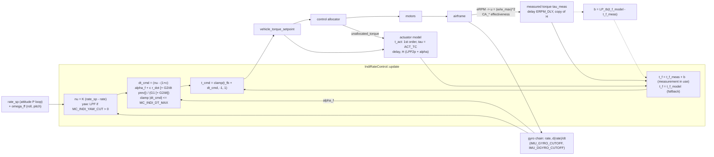

# Chapter 1. Inner-loop design: INDI angular-rate control

Gate G8 requires design first: both loops, block diagram, final parameters, analysis with margins. This chapter covers
the inner (angular-rate) loop. The outer (linear-acceleration) loop is chapter 2.

Firmware state: FREEZE-10 (D-FREEZE-10, firmware 7fe6206fcc), described as it is on branch `feat/indi-flight` at HEAD.
Citations: `L:` = `src/lib/indi_rate_control/indi_rate_control.cpp` (`LH:` = `.hpp`), `M:` =
`src/modules/mc_indi_rate_control/McIndiRateControl.cpp`, `MT:` = `IndiMeasuredTorque.cpp` (same directory, `.hpp`
where marked), `Y:` = `mc_indi_rate_control_params.yaml` in the same directory, `Q:` =
`indi_flight/bench/params/quad5in_indi_defaults.params`. `D-...` are entries of `indi_flight/DECISIONS.md`. Decision ids
are cited in this report only, not in firmware.

## 1. Role and placement

The module `mc_indi_rate_control` is started instead of `mc_rate_control` when `MC_INDI_EN = 1` (Y:`MC_INDI_EN`, reboot
required; startup `ROMFS/px4fmu_common/init.d/rc.mc_apps:17-20`). Only one rate controller runs. The module refuses to
start if another controller already publishes `vehicle_torque_setpoint` (M:70-78). There is no PID fallback inside the
module.

The module is a thin wrapper around the pure library class `IndiRateControl` (`src/lib/indi_rate_control`, no uORB, no
dynamic memory, LH:75). The library holds the law; the module supplies the signals and the measured
torque. The loop runs on every `vehicle_angular_velocity` sample (callback, M:304-312), at the rate of the gyro chain
(bench rates 800, 400 and 266.7 Hz, D-RATE267).

Inputs consumed:

| Input | uORB / source | Use |
|---|---|---|
| Rate and its derivative | `vehicle_angular_velocity` (`xyz`, `xyz_derivative`) | `rate`, filtered angular acceleration `alpha_f` (M:313-316) |
| Rate setpoint | `vehicle_rates_setpoint` (from the attitude P loop) | `rate_sp` |
| Rate feed-forward | `indi_rate_feedforward` (from chapter 2), roll and pitch | added to `rate_sp` at use (M:386-396) |
| Allocator feedback | `control_allocator_status` (`unallocated_torque`) | allocated torque of the previous cycle (M:226-229, M:430-435) |
| Rotor speed | `esc_status` eRPM, `actuator_motors` | measured torque (M:162-217) |
| Land detector | `vehicle_land_detected` (`landed`, `maybe_landed`) | ground handling (M:321-326) |
| Parameters | `MC_INDI_*`, `IMU_GYRO_CUTOFF`, `IMU_DGYRO_CUTOFF`, `CA_*` | law, filters, measured torque (M:88-160) |

Published outputs: `vehicle_torque_setpoint` and `vehicle_thrust_setpoint` (normalised, M:442-452), `indi_rate_status`
(logging, M:262-274), `actuator_torque_measured` (M:208-217).

## 2. Block diagram



The two members of the feedback pair are `alpha_f` (filtered measured angular acceleration) and `t_f` (the torque that
produced it, passed through the same filter chain and delay). Their difference is what the airframe did not do as
commanded, so the law needs no disturbance estimator and no integrator (LH:75: "There is no integrator").

## 3. The law

All quantities are per axis in normalised torque space: torque in [-1, 1], `G1` in rad/s^2 per unit normalised torque.

### 3.1 Desired acceleration and rate prediction lead

```
nu    = K .* (rate_sp - rate)                      L:411        (roll, pitch: rate_sp includes omega_ff, M:438-440)
c     = min(lead_scale * K * tau_c, 2)             L:450-453, LH:301   (0 on ground), tau_c = MC_INDI_ACT_TC
r_dot = LP(d rate_sp/dt), tau 0.03 s, |r_dot| <= 1000 rad/s^2   L:399-405, LH:279-283   (0 on ground)
```

`K` is `indiEffectiveGainK(K_set, MC_INDI_ID_OK == 1)`: the set bandwidth gains while the physical parameters are
identified, half of them otherwise (LH:392-395, M:96-98). The lead `c` cancels the actuator lag in the feedback path
(the feedback torque `t_f` already carries it), so that `nu_eff = K (1 + tau_c s)(rate_sp - rate)` and a moving rate
setpoint is not followed with the actuator lag (LH:50-53). `MC_INDI_LEAD = 0` turns both lead terms off. `r_dot` is 0 in
the first cycle, after `reset()` and `resetSetpointLead()`, on ground and on rejected cycles, so no derivative impulse
enters the law (L:394-396). The module calls `resetSetpointLead()` when the source of the setpoint changes (M:407).

### 3.2 Filters and delay matching

The gyro derivative `alpha_f` comes from the sensor chain: a second-order low pass `IMU_GYRO_CUTOFF` followed by a
first-order low pass `IMU_DGYRO_CUTOFF` on the derivative. The torque `t_f` must see the same lag, or the difference
`nu - (1 + c) alpha_f` carries a filter artefact. The library therefore builds the same chain `H` on the torque
(L:288-294):

```
t_act[k] = t_act[k-1] + (1 - exp(-dt/tau_c)) (t_alloc[k] - t_act[k-1])    L:271-272   actuator model, tau_c in [0.001, 0.2] s (L:49)
t_del    = t_act delayed by MC_INDI_DELAY samples (ring buffer, <= 4)       L:276-286
t_f_model = alpha_filter( LPF2p( t_del ) )                                  L:291-294   H, cutoffs mirror the sensor chain
```

`setFilterCutoffs` receives `IMU_GYRO_CUTOFF` and `IMU_DGYRO_CUTOFF` from the parameter store (M:136-148); a cutoff
<= 0 makes that stage pass-through, as in the sensor chain (LH:150-153). The filters are designed on a low-passed
sample rate, redesigned only when it moves by more than 10 % or a cutoff changes, so dt jitter does not reset the pair
(L:244-260, LH:166-167). A change of the delay in flight moves one sample per cycle (L:276-281). The measured path has
its own delay (`MC_INDI_ERPM_DLY`) and its own copy of `H` with the same cutoffs (L:306-323).

An optional second-order low pass at `MC_INDI_YAW_CUT` Hz is applied to the yaw component of `alpha_f`, `t_f`, the yaw
rate error and the yaw setpoint, with identical coefficients so the pair stays synchronised (L:364-392, LH:55-58, LH:155-160). It
is disabled at 0 or above 0.45 times the sample rate; roll and pitch are never affected.

### 3.3 Inversion and bounds

Roll and pitch (L:455-460):

```
dt_cmd = (nu - (1 + c) alpha_f + c r_dot) / G1
t_cmd  = clamp( t_fb + clamp(dt_cmd, +-MC_INDI_DT_MAX), -1, 1 )            L:468-473
```

`t_fb` is `t_f` in flight and 0 on ground (section 5). Both `alpha_f` and `t_f` are filtered by the same chain, so on
a plant that follows `alpha = G1 t` the feedback pair cancels and `t_cmd` is the previous torque plus the increment
that produces `nu`.

### 3.4 Removal of the steady command/output gap (battery sag, weak motor)

With the measured torque in use (section 4) `t_f` would equal the true output torque. A motor that delivers less than
its command (low battery, weak motor, thrust-map error) leaves a steady gap between the command and the output. With
measured torque alone the law no longer sees the gap as an error that persists, which removes the integral action of
the model state: one motor at 0.8 held a 10.4 deg standing attitude error (D-RATE-BLD, A-33).

The library therefore blends the measured and the modelled torque (L:331-357, LH:70-74):

```
b      <- b + dt/(tb + dt) ( t_f_model - t_f_meas - b )     tb = MC_INDI_ACT_BLD, measurement in use, not landed, not maybe_landed
b      <- t_f_model - t_f_meas                              otherwise (tracks the gap, every switch is bumpless)
|b|    <= 2 per axis                                        LH:303
t_f    =  t_f_meas + b                                      measurement in use
```

The measurement carries the high frequencies, the model the low ones. The model state follows the command through the
allocator feedback (section 6), so a steady shortfall of the motor appears as `t_f_model - t_f_meas` and `b` carries it
at DC with time constant `tb`. `tb = 0` (or a negative value) disables the blend and gives the measured torque alone
(LH:125-128). The default of 1.0 s was chosen with a weak-motor closed-loop unit test (tb 0: 0.25 rad/s standing
error, tb 1: 1.6e-5, D-RATE-BLD S77) and is below the rate crossover (about 4 Hz), so it does not move the
margins (section 8). `b` is frozen while `maybe_landed` (D-S3-LANDED, L:337-341).

### 3.5 Saturation and priority

The law has no integrator, so there is no windup state. Saturation enters in three places:

- The increment is bounded to `MC_INDI_DT_MAX` per cycle and the output to [-1, 1] (L:468-473). The default 1.0 is
  the full range (the bound is inactive).
- The actuator model is fed with the torque the allocator actually produced from the previous setpoint, not with the
  setpoint: `torque_allocated_prev = prev_setpoint - unallocated_torque`, when the allocator status is newer than the
  previous setpoint (M:226-229), bounded to [-1, 1] (L:267-269). So the model state, and through the blend the
  feedback pair, see the clipped torque.
- The measured torque is the real output and shows saturation directly.

Priority between axes and thrust when the allocator saturates is handled by the stock control allocator, which this
design does not change; the module only reports the unallocated torque back into the law.

**Known limit (G3 NOT PASSED).** G3 robustness is not passed at FREEZE-10. In the C3 corner (saturation together with a
weak motor: draw 264: thrust scale 0.351, motor 3 at 0.709, mass 1.3) INDI loses control (tilt > 60 deg) while the
PID reference recovers. The failure does not depend on `MC_INDI_ACT_TC` in the tested range. See `GATES.md`,
"G3 verdict, re-fly with drawn controller ACT_TC (S213)". Not analysed further here.

### 3.6 Yaw: rotor spin-up term (G2)

Yaw torque comes from a change of rotor speed, and the rotor inertia reacts on the body: the plant is
`(G1 + G2 s) Delta = nu - (1 + c) alpha_f` on the increment. The library inverts it with the backward-Euler form
(L:455-460, LH:60-64):

```
(G1 + G2/dt) dt_cmd = nu - (1 + c) alpha_f + c r_dot + (G2/dt) Delta_prev        Delta_prev = t_cmd - t_fb of the previous cycle (yaw only, 0 on ground)
```

This is a first-order low pass on the increment with DC gain 1/G1 and time constant `G2/G1`, independent of dt
(LH:63). `G2/G1` is not the motor time constant. `Delta_prev` is the increment that reached the output after
clamping (back calculation, L:475-477). `G2 = 0` gives the roll and pitch form. G2_Y of the reference airframe is
derived from rotor inertia (D-G2Y-DERIVE: `G1_Y J_r / (2 k_m w_h)` = 27); `J_r` is an assumption, see Unverified. The
earlier dead-beat form was replaced because it made the yaw gain depend on dt (D-YAW-INV).

## 4. Measured versus modelled actuator state

Two sources feed `t_f`:

- **Model**: the first-order actuator model driven by the allocated torque (section 3.2).
- **Measured**: `tau_meas = B (u - u_trim)`, with `u = (omega / omega_max)^2` clamped to [0, 1] per motor, `omega = eRPM
  2 pi / 60` (MT:182-187, LH:199-208), `omega_max = MC_INDI_W_MAX` and `B` the effectiveness matrix of the control
  allocation library built from the `CA_*` parameters, scaled as the allocator scales it (M:143-160, MT:56-87, MT:48-54).
  Rows with all entries under 0.05 are zeroed, as in the allocator (MT:63-78). `MC_INDI_W_MAX = 0` disables the measured
  path entirely (Y:`MC_INDI_W_MAX`), and an invalid geometry also yields no measured torque (M:157-160).

The measurement is used only after `kMeasValidCycles = 20` consecutive valid cycles; any invalid cycle drops back to the
model at once. There is no per-axis mixing, as model and measurement differ in lag and units (L:325-328, LH:295). While
invalid, the measurement path is fed the modelled `t_act`, so the switch back is bumpless (L:296-304). The blend state
`b` follows the instantaneous gap while the measurement is not in use (L:343-345), which is the D-RATE-BLD-EDGE choice.

**Telemetry validity** (M:226-236, MT:200-249). The measured torque is valid only if every rotor has a fresh, finite,
plausible sample:

- the oldest ESC sample is younger than `MC_INDI_ERPM_TO` (default 0.02 s; also bounded by `SAMPLE_MAX_AGE_US` = 20 ms
  at MT:hpp:74);
- the motor is online (`esc_online_flags`, M:197-202) and the error counter did not change (a dropped frame skips the
  sample, MT:175-180);
- rpm >= 0 and `omega / omega_max <= 1.5` (MT:186, MT:hpp:76);
- not frozen (below).

Any invalid motor makes the whole torque invalid, which sends the law to the modelled path within one cycle.

**Frozen value detection** (D-S3-FROZEN, MT:106-163). A motor whose reported rpm is bit-identical for
`MC_INDI_ERPM_FRZ` (0.5 s) while armed, and whose command varied by more than 0.02 in the same window, is latched
frozen and treated as invalid until the rpm changes (MT:127-141; a constant command only restarts the window, because
a constant rpm is then legitimate). The detection restarts at arming and disarming (MT:114-124). The masks are
published in `actuator_torque_measured` (`motor_valid_mask`, `motor_frozen_mask`, M:208-217).

**Airframe requirement R1 is not enforced by code.** `design/airframe_requirements.md` R1 says INDI refuses to arm
without eRPM telemetry on every motor. No such check exists in the module (the only refusal is the second-controller
check at M:70-78). Without telemetry, `MC_INDI_W_MAX = 0`, or a missing `CA_*` geometry, the modelled path runs
instead, and the law still flies with the actuator model and no blend. The only protection is the lower gain level of
section 6 before identification.

## 5. Ground, landed handling and faults

- **Landed** (hard, from `vehicle_land_detected.landed`): the feedback torque `t_fb` is held at 0 (the measured
  acceleration carries no information about the torque on the ground), the lead gain `c` and `r_dot` are 0, the yaw
  increment state is 0, and the blend follows the gap. The actuator model and both filter chains keep running, so the
  pair is synchronised at take-off (L:262-264, L:416, L:450-453). On both edges of `landed` the feedback torque is
  ramped with slew `MC_INDI_LND_SLEW` (5 per second, full range in 0.2 s) rather than stepped (L:419-443, D-S3-LANDED).
- **Maybe landed**: the law runs in full; only the blend integrator is held. There is no output slew limit in flight
  (L:337-341).
- **Disarmed**: the module resets the library each cycle (M:422-426); the blend and filters restart at arming.
- **Rejected cycles**: a non-finite input, `dt` outside [0.000125, 0.02] s, invalid `G1` (< 0.001), or a non-finite
  increment make `update()` fault. The last valid torque is held for `kFaultHoldCycles = 3` cycles, then the states are
  reset and the torque is zero (L:195-222, L:231-240, LH:98).
- **Rate setpoint timeout** (D-S3-SPTO): when armed and the mode uses the rate setpoint, a setpoint older than
  `MC_INDI_SP_TO` (0.5 s) is stale; rates are zeroed with thrust held and a warning is emitted at most every 2 s
  (`RateSetpointWatchdog.cpp:36-56`, M:377-383, M:417).
- **Feed-forward gate**: `omega_ff` is applied only if valid, younger than 50 ms, not landed, not in acro and not stale
  (`IndiRateFeedforwardGate.cpp:36-45`, `.hpp:47`).

## 6. Final parameters (FREEZE-10)

`MC_INDI_*` of the rate module (Y). "Q" values are the quad5in set (Q) the frozen flights and campaigns use; "yaml" is
the firmware default. Sources: **derived** = from airframe data, not identified in flight; **identified** = from a
flown identification or the model time constant; **bandwidth default** = design value, not tied to an airframe.

| Name | quad5in (Q) | yaml | Unit | Meaning | Source |
|---|---|---|---|---|---|
| `MC_INDI_EN` | 1 (Q:3) | 0 (Y:12) | - | start INDI rate module instead of `mc_rate_control`, reboot | switch |
| `MC_INDI_W_MAX` | 2700 (Q:5) | 0 (Y:27) | rad/s | rotor speed at full thrust; 0 disables measured torque | derived: `SIM_GZ_EC_MAX` of 4040_gz_quad5in |
| `MC_INDI_G1_R` | 1757 (Q:7) | 1757 (Y:34) | rad/s^2 | roll control effectiveness | derived, fit within 0.8 % (D-G1-DERIVE) |
| `MC_INDI_G1_P` | 1640 (Q:9) | 1640 (Y:45) | rad/s^2 | pitch control effectiveness | derived, fit within 0.8 % |
| `MC_INDI_G1_Y` | 205 (Q:11) | 205 (Y:58) | rad/s^2 | yaw control effectiveness | derived (`design/a43_closing_s126.md:50`) |
| `MC_INDI_G2_Y` | 27 (Q:13) | 27 (Y:74) | rad/s | yaw rotor spin-up term | derived (D-G2Y-DERIVE), `J_r` assumed |
| `MC_INDI_ID_OK` | 0 (Q:15) | 0 (Y:86) | - | 1 = physical parameters identified; 0 halves K | status gate (D-DEFAULTS-FW) |
| `MC_INDI_K_R` | 20 (Q:17) | 20.0 (Y:94) | rad/s | roll rate bandwidth (10 effective at ID_OK 0) | bandwidth default |
| `MC_INDI_K_P` | 20 (Q:18) | 20.0 (Y:105) | rad/s | pitch rate bandwidth | bandwidth default |
| `MC_INDI_K_Y` | 20 (Q:19) | 20.0 (Y:116) | rad/s | yaw rate bandwidth (was 10, D-KY) | bandwidth default |
| `MC_INDI_ACT_TC` | 0.033 (Q:21) | 0.05 (Y:130) | s | actuator model and lead time constant | model tau (identified rule: D-ACTC-RULE) |
| `MC_INDI_LEAD` | 1 (Q:23) | 1 (Y:144) | - | rate lead scale, 0 off | bandwidth default (D-RATE-LEAD) |
| `MC_INDI_DELAY` | 0 (Q:25) | 0 (Y:154) | cycles | delay of the modelled torque | computed from filter config, not identified |
| `MC_INDI_ERPM_DLY` | 1 (Q:27) | 1 (Y:164) | cycles | delay of the measured torque | identified by correlation lag (Q:26 comment) |
| `MC_INDI_ERPM_TO` | 0.02 (Q:29) | 0.02 (Y:174) | s | age above which measured torque is invalid | default, flown unchanged |
| `MC_INDI_ACT_BLD` | 1.0 (Q:30) | 1.0 (Y:189) | s | blend time constant `tb`; 0 off | bandwidth default (D-RATE-BLD) |
| `MC_INDI_DT_MAX` | 1.0 (Q:31) | 1.0 (Y:200) | - | increment bound per cycle and axis | default, inactive at 1.0 |
| `MC_INDI_LND_SLEW` | 5.0 (Q:32) | 5.0 (Y:214) | 1/s | landed-edge feedback torque slew | default (D-S3-LANDED) |
| `MC_INDI_ERPM_FRZ` | 0.5 (Q:33) | 0.5 (Y:227) | s | frozen rotor speed window | default (D-S3-FROZEN) |
| `MC_INDI_SP_TO` | 0.5 (Q:34) | 0.5 (Y:240) | s | rate setpoint timeout | default (D-S3-SPTO) |
| `MC_INDI_YAW_CUT` | 0 (Q:35) | 0 (Y:252) | Hz | yaw low pass cutoff, 0 off | default, off |

That is 21 parameters (20 tuning parameters plus the enable switch). Eight `MC_INDI_INJ_*` parameters
(Y:260-363: axis, amplitude, period, band, periods, delay, break point, setpoint ramp amplitude) drive the bench loop-break
excitation of G2 (D-G2-INJ) and are off by default (`MC_INDI_INJ_AX` 0); they are not part of the flight design.
Library constants, not parameters: `kMeasValidCycles` 20, `kFaultHoldCycles` 3, `kMaxBlend` 2, `kMaxLeadGain` 2,
setpoint-lead time constant 0.03 s, `kMaxDelaySamples` 4 (LH:98, LH:279-303). The rate loop also reads
`IMU_GYRO_CUTOFF` and `IMU_DGYRO_CUTOFF` (not owned by this module) and the `CA_*` rotor geometry.

Effective bandwidth at the frozen defaults: with `MC_INDI_ID_OK = 0` the loop runs at `K` = 10 rad/s, half the set
value. Bench runs that intend full gains set `ID_OK 1` (Q:14, Q:16 comments).
`ACT_TC` stays 0.05 in firmware for unidentified airframes, 0.033 on quad5in (D-DEFAULTS-FW amendment).

## 7. Identification and generic defaults

The G1 and G2 values above are derived from airframe data; the firmware defaults for G1/G2_Y are the quad5in values
(1757/1640/205/27) because a G1 above the true value lowers the loop gain, so they are the conservative side for larger
airframes, while the former generic values (320/210/30) would have multiplied the loop gain 5 to 8 times on quad5in
(D-DEFAULTS-FW). `ACT_TC` is the parameter the identification step returns (D-ACTC-IDENT, D-ACTC-RULE: identified
`tau_sym`); the G3 controller box is `r x tau_mean`, `r` in [0.88, 1.02] (D-OWNER-Q28).

## 8. Margins (rate loop)

Evidence: `indi_flight/report/g2_margins.md` (section 2.1, preliminary, pre-freeze binaries) and
`indi_flight/GATES.md` "G2 verdict at freeze-10" (S194). Limits: PM at least 45 deg, GM at least 6 dB (where a -180
crossing exists), delay margin well above two control periods plus telemetry latency.

| Cell | GM dB | PM deg | DM ms | f_c Hz | Source |
|---|---|---|---|---|---|
| roll, measured path, 800 Hz, HEAD dcba400943, bld 0 | 16.2 | 69.1 | 47.1 | 4.07 | g2_margins.md 2.1, `results/stage3_s77_a34` |
| roll, measured path, 800 Hz, bld 1.0 | 15.8 | 68.9 | 46.5 | 4.12 | same |
| roll, measured path, 400 Hz, bld 0 / 1.0 | 13.3 / 13.3 | 70.5 / 70.4 | 50.8 | 3.85 | `results/stage3_s77_400` |
| roll spot at FREEZE-10, `roll800_fwdef_s2` | 15.7 | 46.9 | 75.5 | - | GATES.md G2 verdict freeze-10 |

The blend time constant does not move the margins (PM 68 to 69 deg at `tb` 1.0, 0.3, 0.1; D-RATE-BLD S76). At FREEZE-10
only the roll spot cell was scored for the rate loop; its PM margin over the limit is thin (+1.9 deg, GATES.md
evidence limit 2). The pre-freeze roll cells show PM 69 deg, and the freeze-10 spot PM is lower (46.9 deg). The source does not
explain the difference; the pre-freeze cells use other binaries (A-34 shows the setpoint lead alone moved PM by about 9 deg, g2_margins.md 2.1). Pitch and yaw rate margins and the 266.7 Hz measured-path cell were not
flown on the frozen pair (g2_margins.md 2.2, section 4). The model-only fallback at HEAD has no flown margin either.

## History pointers

- Architecture of the law: D-G2-BREAK, D-G1-DERIVE, D-RATE-LEAD (and addenda), D-YAW-INV, D-G2Y-DERIVE.
- Gap removal: D-RATE-BLD, D-RATE-BLD-EDGE; the outer-loop twin is D-GAP in chapter 2.
- Ground and faults: D-S3-LANDED, D-S3-FROZEN, D-S3-SPTO, D-S3-ATT-STEP (setpoint lead).
- Defaults and identification: D-IDENT, D-DEFAULTS-FW, D-KY, D-OWNER-Q27, D-ACTC-IDENT, D-ACTC-RULE, D-OWNER-Q28.
- Freeze and verdicts: D-FREEZE-10, G2 verdict at freeze-10 and G3 verdicts in `GATES.md`.

## Unverified

- Margin numbers come from `g2_margins.md` and `GATES.md`, not from the result folders; the pre-freeze rows used
  binaries other than FREEZE-10 and are listed as trend only. [open: needs re-scoring of result folders]
- The G3 C3 corner description is taken from the S213 verdict text; the "mass 1.3" figure has no unit in the source and
  is not interpreted. [open: waits Q31 (G3 verdict); unit of mass 1.3 not stated in source]
- `J_r = 5e-6` (rotor inertia) behind `G2_Y = 27` is assumed in D-G2Y-DERIVE; the IV fit of `G1_Y` (163 to 166) disagrees with
  the derived 205 (Q:10 comment, A-43/A-44 unresolved). [open: needs identification; A-43/A-44 unresolved]
- `MC_INDI_ACT_TC = 0.033` equals the quad5in model time constant. The identification grid
  (`results/actc_grid_s209/README.md`, symmetric cells) returns `tau_sym` within 0.4 % of the true value on this plant,
  so the quad5in value agrees with D-ACTC-RULE in simulation. The params file comment (Q:20) still reads UNVERIFIED. [open: hardware; S217: params comment `bench/params/quad5in_indi_defaults.params:20` still reads UNVERIFIED]
- `MC_INDI_DELAY = 0` is computed from the bench filter configuration (Q:24); valid for other `IMU_*` cutoffs is
  UNVERIFIED (Q:24). [open: needs flight with other IMU_* cutoffs]
- Where the control allocator saturates and which axis it favours was not read in this chapter (stock allocator). [open: stock allocator out of scope]
- The cause of the lower freeze-10 spot PM compared with the pre-freeze rows is not established here. [open: needs cause search or flight]
- Exact filter orders of the sensor chain are taken from the library header text (LH:150-153) and the module, not from
  `src/modules/sensors`. [open: `src/modules/sensors` not read]
- Whether ID_OK was 1 in every G2 and G5 flight: stated from the bench-run note in Q:16, not checked per run. [open: needs per-run param check of run logs]
- Line numbers refer to the working tree at HEAD; unit tests (`indi_rate_control_test.cpp`, module test files) were not
  read. Headers for `RateSetpointWatchdog` and the feed-forward gate were read only through their `.cpp` and one
  constant each. [open: unit tests not read]
- The module yaml `MC_INDI_ACT_TC` text claims margins hold up to twice the true time constant with the lead; this is
  the S53 rule overturned by D-OWNER-Q27. Checked S215 and S217: the yaml still says "when unsure, round up"
  (`src/modules/mc_indi_rate_control/mc_indi_rate_control_params.yaml:126-128`; the earlier citation "module.yaml:127-128" was a wrong path);
  default there is 0.05. [open: waits the G7 parameter pass]
