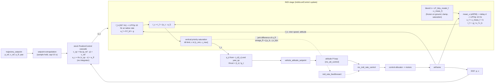

# Chapter 2. Outer-loop design: INDI linear-acceleration control

Gate G8 requires design first: both loops, block diagram, final parameters, analysis with margins. This chapter covers
the outer (linear-acceleration) loop. The inner (rate) loop has its own chapter.

Firmware state: FREEZE-10 (D-FREEZE-10, firmware 7fe6206fcc), described as it is on branch `feat/indi-flight` at HEAD.
Citations: `L:` = `src/lib/indi_accel_control/indi_accel_control.cpp` (or `.hpp` where marked), `M:` =
`src/modules/mc_indi_pos_control/McIndiPosControl.cpp`, `Y:` = `mc_indi_pos_control_params.yaml` in the same directory,
`SM:` = `IndiStageMode.hpp`, `FS:` = `FailsafeSetpoint.hpp`. `D-...` are entries of `indi_flight/DECISIONS.md`.
Decision ids are cited in this report only, not in firmware.

## 1. Role and placement

The module `mc_indi_pos_control` replaces `mc_pos_control` in every multicopter mode when `MC_INDI_POS_EN = 1`
(Y:`MC_INDI_POS_EN`, reboot required; startup `ROMFS/px4fmu_common/init.d/rc.mc_apps:57-60`). Both modules are never
started together. There is no fallback to the stock thrust path: the stock position controller still runs inside the
module, but only to produce an acceleration reference. Its thrust output is never published (D-F7-GROUND, M:1118,
M:380-384).

Architecture is "base A" (D-outer-arch): the stock cascade (position P, velocity P, no integrator) produces a commanded
acceleration `a_c`, and an INDI stage turns `a_c` into a thrust vector using the measured specific force. The module
reuses the stock `PositionControl`, `Takeoff` and `GotoControl` classes (M header includes
`PositionControl/PositionControl.hpp`, `Takeoff/Takeoff.hpp`, `GotoControl/GotoControl.hpp`), so setpoint handling,
limits, take-off ramp and goto logic are the stock ones. Only the step from acceleration to thrust differs.

Inputs consumed:

| Input | uORB / source | Use |
|---|---|---|
| Setpoint | `trajectory_setpoint` (position, velocity, acceleration, yaw, yawspeed), `vehicle_constraints`, `goto_setpoint` | references of the cascade (M:906-1038) |
| State | `vehicle_local_position` (p, v, reset counters, hover-thrust validity), `hover_thrust_estimate` | cascade feedback, thrust model scale (M:869-875, M:971) |
| Attitude | `vehicle_attitude` | rotation R(q), yaw (M:80-85) |
| Specific force | `vehicle_acceleration` (about 267 Hz, drained on every sample) | measured acceleration (M:90-110) |
| Rotor speed | `esc_status` eRPM, normalised by `MC_INDI_W_MAX` | measured mean thrust u (M:133-165) |
| Collective | `vehicle_thrust_setpoint` | restart value after resets (M:128-131) |
| Allocator | `control_allocator_status` | saturation flag, freezes the blend (M:190-201) |
| Flags | `vehicle_control_mode`, `vehicle_land_detected` | mode, ground handling (M:837, M:1060-1066) |

Published outputs:

| Topic | Content |
|---|---|
| `vehicle_attitude_setpoint` | `q_d` from the INDI thrust vector and the yaw setpoint, `thrust_body = (0,0,-c)` (M:380-384, M:1127-1129) |
| `vehicle_local_position_setpoint` | cascade setpoints plus the INDI thrust vector (consumed by the land detector) (M:1105-1125) |
| `indi_rate_feedforward` | body-rate feed-forward `omega_ff` and a validity flag, consumed by `mc_indi_rate_control` (M:1131-1140) |
| `indi_pos_status` | `a_c`, `a_f`, `t_f`, `t_c`, blend, stage mode, injection (logging) (M:357-378) |
| `takeoff_status` | as stock (M:1149-1157) |

The attitude and rate loops downstream are unchanged by this module except for the rate feed-forward channel.

## 2. Block diagram



The measured specific force closes the acceleration loop (inner loop of the outer controller). The
position/velocity cascade closes the outer loop around it. The thrust model enters only through `t_f`, so an error of
the model gain is a loop-gain error and not an offset (section 3.4).

## 3. The law

Frames: NED world, FRD body, `R = R(q)` body to world, specific thrust `t = -c z_b` with `c > 0`, `g_vec = (0,0,+g)`
(L header comment, `.hpp:36-50`). The accelerometer measures `f_b = R^T (a - g_vec)`.

### 3.1 Outer cascade (stock PID-type, integrator off)

```
v_sp = K_p (p_ref - p) + v_ref                  (velocity limited by MPC_XY_VEL_MAX, MPC_Z_VEL_MAX_UP/DN)
a_c  = K_v (v_sp - v) + a_ff                    (+ D term, stock filters; integrator zeroed every cycle)
```

The module runs `PositionControl::update` and then reads the acceleration from `local_pos_sp.acceleration`
(M:215). The integrators are reset every cycle when INDI is requested and again when the stage ran (M:1073-1075,
M:1116-1119): the INDI increment supplies the integral action (L header comment; D-GAP, D-STAGE-STALE). The library
carries its own `K_pos`/`K_vel` path (L:325-363), but the module calls it with `accel_only = true`
(M:315), so that path is unused in flight and `a_c = a_ref` (L:362).

Gains (M:617-622): horizontal `K_p = MC_INDI_XY_P`, `K_v = MC_INDI_XY_VP` (module-owned, D-OFFB-POSVEL; the reason
is the G5.5 trajectory lag, which depends on the pos/vel bandwidth). Vertical gains stay stock: `MPC_Z_P`,
`MPC_Z_VEL_P_ACC`, `MPC_Z_VEL_D_ACC`; `MPC_XY_VEL_D_ACC` as the horizontal D term. `a_ff` comes from the
trajectory setpoint acceleration after take-off and failsafe edits (M:1112). A held setpoint is extrapolated between
sender samples with `v += a dt`, `p += v dt + a dt^2/2`, dt capped at 0.5 s (`SetpointExtrapolation.hpp`, M:1038).

### 3.2 INDI increment

```
a_f = R f_bf + g_vec                            f_bf = LPF2p_10Hz(f_b)  at the accelerometer sample rate   (L:396-407)
u_f = u_meas_f + b                              u_meas_f = LPF2p(delay_d(mean_u)),   t_f = -g_t u_f z_b   (L:375, L:421-422)
t_c = t_f + (a_c - a_f)                         (L:425)
```

`t_f` is the filtered thrust vector of the actuator (rotor speed squared, delayed and low-passed like the
accelerometer). `a_c - a_f` is the acceleration error. Adding it to the current thrust is the incremental form
`u_c = u_f + G^-1 (a_c - a_f)` with the control effectiveness `G^-1 = 1` in specific-thrust units. The thrust model
scale is `g_t = g / ht` and `k_cmd = 1` (M:203-204). `ht` is the hover-thrust estimate in flight when valid, else
`MPC_THR_HOVER` (M:971). Collective `c = |t_c|` is mapped to the normalised command by `thrust = c / (g_t k_cmd)`,
clamped to `[MPC_THR_MIN, MPC_THR_MAX]` (L:490); `thr_min = 0` until the take-off state is `flight` (M:999).

### 3.3 Filters and delay matching

The accelerometer and the measured thrust pass through the same second-order low-pass filter (cut-off
`MC_INDI_POS_LPF`, Y; `setFilter` L:76-98). The filtered force `f_bf` is computed at the accelerometer rate by
`sampleSpecificForce` (L:100-127). The module is also scheduled on `vehicle_acceleration` and drains every sample
(M:94-109). Reason: filtering after decimation to the 88.9 Hz stage aliased a 95.7 Hz vibration line to 6.8 Hz in
`a_f` (D-AF-ALIAS, fix 2d92dbcf59 and 4afa7a97b6). The filter on the measured thrust runs at the stage rate and uses the
same cut-off, so the two paths have equal magnitude and phase.

The ESC-based thrust is later than the accelerometer. A pure delay of `MC_INDI_POS_DLY` controller cycles
(0 to 4, L `kMaxDelaySamples`, delay line L:371-376) matches it to the force path. The same delay applies to the
modelled path (`_um_buf`), so both stay comparable (L:373-376).

### 3.4 Removal of the steady thrust gap (battery sag, weak motors)

Rotor speed squared underestimates or overestimates the true thrust when motors weaken or the battery sags. Without
correction the outer loop has no integrator and a standing acceleration error remains. Evidence: z error 0.31 m at
85 % motor scale (D-GAP, `results/stage5_s70`). The module uses a complementary blend of the measured and modelled
collective (D-GAP choice d):

```
b <- b + dt/(tb + dt) ((u_model_f - u_meas_f) - b),   b in [-0.5, 0.5]                (L:415-418)
u_f = u_meas_f + b                                                                    (L:421)
```

`u_model = thrust_prev k_cmd` is the commanded collective. At high frequency the measured rotor speed dominates,
at DC `u_f` equals the model, which restores integral action: a gap appears as a rotor-speed deficit and is absorbed.
`tb = MC_INDI_POS_TB = 0.3 s` (Y). Rationale for 0.3 s and the bound `kMaxBlend = 0.5` (`.hpp`): the G5.10 thrust-drop
gap at hover is 0.36 in u units, which the older bound 0.3 could not absorb (D-GAP-G510); margin at `tb = 0.3`: outer z
acceleration-break PM 62.7 deg (r400), 67.3 deg (r800), key2 ACCEPT (D-GAP-G510, S151).

The blend is frozen (L:412-413) while: held by the module (`landed`, `maybe_landed`, modelled-force mode, M:345), the
telemetry is invalid, the collective is clamped at the previous cycle (anti-windup), the measured `mean_u >= 0.98`, or the
allocator reports saturation (M:332). It is never reset by `reset()` (L:160, comment "A16").

### 3.5 Saturation and attitude

1. If `t_c,z > -0.1` it is forced to `-max(c_min, 0.1)` (upward thrust is mandatory, L:435-437).
2. Tilt: the horizontal part is scaled to `h_max = -t_c,z tan(tilt)` (L:445-452). The tilt is `MPC_TILTMAX_AIR` in
   flight and `MPC_TILTMAX_LND` before `flight`, slewed (M:991-993).
3. Collective above `c_max`: the horizontal part is shrunk first and the vertical component kept (L:465-481). Below
   `c_min` the whole vector is scaled (L:483-488). Either sets `_coll_clamped`, which holds the blend next cycle.
4. `z_b,d = -t_c / |t_c|`, `q_d = bodyzToAttitude(z_b,d, yaw_sp)` (L:495-496, L:236-276). The yaw comes from the setpoint,
   or from the current attitude if absent (L:494). `yawspeed_ff` is passed through (L:518).

### 3.6 Jerk feed-forward to the rate loop

`omega_ff = (j.y_b, -j.x_b, 0)/c` from the desired body axes, clamped to 3 rad/s per axis (L:498-507). The jerk is
the difference of the setpoint acceleration `a_ff`, per axis, held for 0.1 s between changes, clamped to 50 m/s^3 and
low-passed with the force filter cut-off (L:197-234). The stock `trajectory_setpoint.jerk` is never read: in auto modes
it is the generator's bang-bang jerk, not the derivative of the published acceleration (D-JFF-SOURCE, M:335-338).
The feed-forward is enabled in every mode (`setFeedforward(true)`, M:57; D-OWNER-Q23 reverted the offboard-only scope
of D-JFF-OFFB). It is published as valid only for full INDI cycles on the measured force, in flight, not landed, and
not in climb-rate-only mode (M:369-370). Source reference: D-A18-REOPEN, D-A18-SOURCE (drag feed-forward rejected).

## 4. Measured versus modelled state

Stage modes (`SM:selectStageMode`, `StageMode`):

| Mode | Condition | Law input |
|---|---|---|
| Bypass | INDI not requested (disarmed, or no position/velocity/climb-rate mode) | stage not run, state tracks the stock collective (M:431-446) |
| Hold | requested, but attitude stale, `a_c` non-finite, or interval above 0.2 s; or `update()` rejected its input | zero-order hold of the last INDI attitude and thrust (M:397-429, D-STAGE-STALE) |
| IndiModelAccel | requested, acceleration stale, or `model_force` (ground, ramp) | modelled specific force |
| Indi | everything fresh, in flight without ground contact | measured specific force and measured rotor speed |

Freshness limit for attitude, acceleration and thrust is 20 ms (`kStageMaxAge`), for eRPM 100 ms, for allocator status
200 ms (M:116-118). Recovery to the measured path needs 20 ms of continuously fresh acceleration (`kAccRecoverTime`,
M:219-234).

Modelled path (library with `f_b_valid = false`): the force is the body force of the same delayed actuator signal that
feeds `t_f`, `f_in = (0,0,-g_t (u_buf[i_d] + b))`, through the same filter (L:383-384, L:403). The measured and
modelled paths are then identical signals, they cancel, and `t_c = a_c - g_vec` in a hover-equivalent form. With
`f_b_valid = false`, `mean_u` is also treated as invalid, so the stage runs on the model alone and the blend is
frozen (L:367, L:413; D-STAGE-STALE a).

Continuity at switches: while telemetry is invalid the measured thrust path is fed `u_model - b`, so `u_meas_f + b` stays
continuous (L:369-370). On the invalid-to-valid edge the native force filter restarts from the force used last cycle
and converges at the filter bandwidth (L:387-392; D-AF-ALIAS key-2 M1). Rotor-speed path: mean u is
`mean_i (omega_i / omega_max)^2` over the four motors, from eRPM and `MC_INDI_W_MAX`; if any motor is offline or `W_MAX`
is unset the value is invalid and the law falls back to the modelled collective (M:133-165). The delay line
(`MC_INDI_POS_DLY`) and the blend restart from the commanded collective at every `reset()` (L:151-182).

## 5. Ground, take-off ramp and landing

One INDI law runs from arming to disarming (D-F7-GROUND). There is no stock thrust path and no hover-thrust hand-over:

- Want-INDI is `armed && (position || velocity || climb_rate enabled)` (SM:`computeWantIndi`).
- Ground (take-off state below `rampup`, or flight with `ground_contact`) and the ramp use the modelled specific force
  (`useModelledForce`, M:1065-1066). The measured acceleration holds the ground reaction and would be wrong.
- On the ground the module replaces the setpoint by `empty setpoint` with `a_z = +100 m/s^2` (M:980-988), which drives
  `t_c` to the minimum thrust (`thr_min = 0`, L:435-437). The tilt limit is `MPC_TILTMAX_LND` and the horizontal
  acceleration is decoupled (M:969, M:990-993).
- In the ramp the stock vertical-speed ramp (`Takeoff::updateRamp`, `MPC_TKO_RAMP_T`, `MPC_TKO_SPEED`, M:1033) gives a
  collective that rises from zero by model inversion. Feed-forward `a_z` is cleared during the ramp (M:976-978).
- Frozen on the ground and in the ramp: the blend `b` (held by `landed`, `maybe_landed` and `model_acc`, M:345), the
  rate feed-forward (invalid unless `flying`, M:369), the stock integrator (reset every cycle, M:987, M:1073-1075).
- At the edge ramp to flight the force switches from modelled to measured. The predicted step is the thrust-model error
  (a few percent of hover). Measured edge step at FREEZE-10: at most 10 % of hover on every take-off (G5 verdict,
  `GATES.md` "G5 verdict at freeze-10"; D-F7-GROUND limit 10 %).
- Landing: the stock land task and `MPC_LAND_SPEED` shape the setpoint. On touch-down `landed`/`maybe_landed` switch to the
  modelled force and hold the blend, so the ground reaction cannot wind anything up. The vertical measurement uses the
  altitude derivative weighted by `|v_sp,z| / MPC_LAND_SPEED` while descending (M:1041-1051).
- Arm and disarm edges restart the INDI state (blend, held setpoint, stale latch, differencing) (SM:`shouldResetStageState`,
  M:837-842). The bench injection restarts too.

## 6. Mode coverage and resets

Every mode with `flag_multicopter_position_control_enabled` runs through the same module and the same stage, so each
inherits the INDI law. The module keys on the control-mode flags, not on mode names:

| Flags | Stage use |
|---|---|
| position or velocity enabled (Position, Hold, Mission, RTL, Land, Takeoff, Orbit, Follow, Offboard position/velocity/acceleration, goto) | full INDI: `a_c` from the cascade, thrust direction from INDI |
| climb-rate only (Altitude, Descend failsafe) | `z_only`: INDI collective, direction of the stock thrust vector, rate feed-forward 0; the stock direction must be finite and at least 5.7 deg above horizontal (`thrust_dir_z < -0.1 |n|`) else the stage holds (L:296-307, L:439-442; SM:`deriveZOnly`) |
| none of these (Manual, Stabilized, Acro, offboard attitude/rate) | not served by this module (stock attitude and rate paths) |

Trajectory-class modes (Position, goto, offboard) and PositionTriplet modes (Hold, Mission, RTL, Land) are produced
by the unchanged flight-mode manager; the module consumes `trajectory_setpoint` (requirements mode table,
`design/outer_loop_requirements.md` section 5). G5.1 to G5.11 verify the modes (section 8).

Estimator resets: setpoint and position-controller filters are corrected as stock (`adjustSetpointForEKFResets`,
M:1190-1252). Any reset counter change (xy, z, vxy, vz, heading) clears only the jerk history
(`resetJerkHistory`, M:306-311, `EkfResetDetect.hpp`). Measured force, mean `u`, delay lines and the previous thrust are
frame independent and are kept (D-T10-RESET: re-seeding them from one raw sample gave a 1.9 deg tilt spike at a yaw
reset). Full `reset()` happens at position-control entry, Hold-to-run, and when the stage restarts (M:239-264, M:296-304),
and keeps the blend (L:160).

Failsafe setpoints (`FS:computeFailsafeSetpoint`, M:1164-1187, M:1085-1102): if the setpoint is stale or the cascade
fails, a fallback within 200 ms of the last valid setpoint is tried, then a failsafe setpoint:

- velocity xy finite: velocity 0 in xy ("stop and wait"); not finite: acceleration 0, descend at land speed ("blind land");
- vz finite: hold vz = 0 unless blind land; vz not finite: acceleration z = +0.3 m/s^2 ("blind descent", a bit below hover).

The failsafe setpoint goes through the same INDI stage, so there is no stock-thrust path. Invalid acceleration, attitude
or `a_c` map to Hold, never to the stock thrust (D-STAGE-STALE, SM).

## 7. Final parameters (FREEZE-10)

Values: yaml defaults (Y) and the freeze set `results/g5_freeze_s157/params.params` (D-FREEZE-10: "config unchanged,
XY gains at firmware defaults 1.2/2.4"). Parameters not listed in the freeze file take the yaml or stock default.

INDI outer-loop parameters:

| Parameter | FREEZE-10 value | Unit | Meaning | Source |
|---|---|---|---|---|
| `MC_INDI_POS_EN` | 1 (yaml default 0) | bool | start `mc_indi_pos_control` instead of `mc_pos_control` | freeze file L39 |
| `MC_INDI_POS_LPF` | 10.0 | Hz | cut-off of the identical 2nd-order filters on force and thrust | Y, freeze file |
| `MC_INDI_POS_DLY` | 1 | cycles | delay of the ESC thrust to match the accelerometer | Y, freeze file |
| `MC_INDI_POS_TB` | 0.3 | s | blend time constant that restores the thrust model at DC (0 = off) | Y, freeze file, D-GAP-G510 |
| `MC_INDI_XY_P` | 1.2 | 1/s | horizontal position gain (replaces `MPC_XY_P`) | Y, D-XY-PICK, D-FREEZE-10 |
| `MC_INDI_XY_VP` | 2.4 | 1/s | horizontal velocity gain (replaces `MPC_XY_VEL_P_ACC`) | Y, D-XY-PICK, D-FREEZE-10 |
| `MC_INDI_PINJ_AX` | 0 | enum | bench multisine axis (0 off, 1 N, 2 E, 3 D); off in flight | Y |
| `MC_INDI_PINJ_PT` | 0 | enum | injection point (0 stage input, 1 stage output) | Y, D-G2-PINJ |
| `MC_INDI_PINJ_AMP/TP/FLO/FHI/NP/DLY` | 0.05 / 20 / 0.2 / 8 / 3 / 0 | m/s^2, s, Hz, Hz, periods, s | bench injection shape (G2 only) | Y |
| `MC_INDI_W_MAX` | 2700 (airframe `4040_gz_quad5in`, freeze file) | rad/s | rotor speed at u = 1, defines `mean_u` from eRPM | freeze file, yaml of the rate module |

Stock parameters used by the module (not set to INDI-specific values):

| Parameter | Value in the freeze setup | Source |
|---|---|---|
| `MPC_THR_HOVER` | 0.137 | airframe `4040_gz_quad5in` |
| `MPC_THR_MIN` | 0.05 | airframe `4040_gz_quad5in` |
| `MPC_THR_MAX` | 1.0 (stock default) | stock yaml |
| `MPC_Z_P` / `MPC_Z_VEL_P_ACC` / `MPC_Z_VEL_I_ACC` / `MPC_Z_VEL_D_ACC` | 1.0 / 4.0 / 2.0 (integrator unused) / 0.0 (stock defaults) | stock yaml |
| `MPC_XY_VEL_D_ACC` / `MPC_XY_VEL_I_ACC` | 0.2 / 0.4 (integrator unused) (stock defaults) | stock yaml |
| `MPC_TILTMAX_AIR` / `MPC_TILTMAX_LND` | 45 / 12 deg (stock defaults) | stock yaml |
| `MPC_VEL_LP`, `MPC_VELD_LP` | 0 (off) / 5 Hz (stock defaults) | stock yaml |
| `MPC_XY_VEL_MAX` | 12 m/s (stock default) | stock yaml |
| `MPC_TKO_RAMP_T`, `MPC_TKO_SPEED` | 3.0 s, 1.5 m/s (stock defaults) | stock yaml |
| `MC_ROLL_P`, `MC_PITCH_P` | 8.0 (downstream attitude loop) | airframe |

Library constants (not parameters, `.hpp`): `kMaxBlend 0.5`, `kMeanUSatLimit 0.98`, `kMaxJerk 50 m/s^3`,
`kMaxOmegaFf 3 rad/s`, `kJerkHold 0.1 s`, `kMinUpThrust 0.1 m/s^2`, `kMaxDelaySamples 4`. Module constants:
`kStageMaxAge 20 ms`, `kAccRecoverTime 20 ms`, stage `dt` limits 2 ms to 0.2 s (`SM`, `kStageDtMin/Max`).

Flagged, not confirmed: stock values for the `MPC_*` rows come from the stock yaml and the airframe file, not from a
parameter dump of a freeze flight (the freeze params file lists no `MPC_*` outside what the airframe sets).
`MPC_Z_VEL_MAX_UP/DN` and `MPC_THR_MAX` have no confirmed value here.

## 8. Margins (G2 outer loop at FREEZE-10)

Evidence: `indi_flight/results/freeze10_s193/G2_SCORES.md` (outer table, section "Re-score S194"), verdict in
`indi_flight/GATES.md` "G2 verdict at freeze-10" (S194). Limits (as freeze-8 and freeze-9): PM at least 45 deg, GM at least
6 dB (no limit where there is no -180 crossing in 0.2 to 8 Hz), gain-reduction margin at least 6 dB near -180 deg (Q13 A),
delay margin at least 2 control periods plus telemetry latency (never binding). Two independent scorers (key 1 and key 2);
key agreement: |dPM| at most 3 deg and |dGM| at most 1 dB. Cells: injection point `pt0` (input of the stage, velocity/position
loop with the acceleration loop closed) and `pt1` (output of the stage, plant-input break), axis `ax1..ax3` (N, E, D),
two bench rate values `r400`/`r800` and two seeds (D-G2-PINJ).

| Measure | Result (24 cells) | Worst cell |
|---|---|---|
| Phase margin | 24/24 at least 45 deg, min **49.1 deg** | `pt0_ax2_r400_s2` |
| xy gain margin (primary) | min **13.5 dB**, 24/24 pass | `pt0_ax1_r400_s1` |
| Plateau gain margin (key 2) | min **12.9 dB** (12.88) | `pt0_ax2_r400_s1` |
| z axis (`ax3`) | no -180 crossing in 4/8 cells (no GM limit); GM present 22.4 dB (key 2: 17.8) in one cell; PM 58.7 to 66.2 deg | `pt1_ax3_*` |
| Delay margin | min **229 ms**, 24/24 | `pt1_ax3_r800_s1` |
| Hole report (log gaps) | 24/24 PASS after one re-fly of `pt1_ax2_r400_s2` (single 22.5 ms gap; re-fly PM 56.9, GM 13.9, holes PASS) | |
| Key-2 agreement | 21/24; 3 cells BLOCKED on key agreement only, both keys pass the margin limits | below |

Cells blocked on key agreement (margins pass in both keys; owner decision, not re-flown):

| Cell | Key 1 PM / GM | Key 2 PM / GM | Reason |
|---|---|---|---|
| `pt1_ax1_r800_s1` | 71.3 deg / 14.4 dB | 67.8 deg / 14.5 dB | dPM -3.48 deg beyond 3 deg |
| `pt1_ax3_r400_s2` | 58.7 deg / n/a | 58.2 deg / 16.3 dB | GM present in key 2 only |
| `pt1_ax3_r800_s2` | 66.2 deg / 22.4 dB | 64.7 deg / 17.8 dB | dGM -4.57 dB beyond 1 dB |

Reading of the margins: phase margin about 49 to 71 deg and gain margin at least 12.9 dB in xy confirm that the
position/velocity cascade at `MC_INDI_XY_P/VP = 1.2/2.4` closes around the INDI acceleration loop with the 10 Hz
filters, delay 1 and blend `tb = 0.3 s` (blend corner below the crossover, D-GAP-G510 S151: xy at `tb = 0.3`
PM 51.4 / 65.2 deg, GM 16.8 dB, probe unkeyed). Freeze-9 values for comparison are in the same table (worst xy PM 48.5,
GM 13.4, min DM 354 ms to 273 ms). Evidence limits carried from freeze-9 (GATES.md): 250 Hz not measured, key 2 BLOCKED on
three cells. G2 spot cells for the rate and attitude loops belong to the inner-loop chapter.

Related closed-loop evidence: G5 PASS at FREEZE-10 (`results/freeze10_s193/G5_SCORES.md`,
`G5_VERDICT_AUDIT.md`), including no thrust step at the ramp to flight (at most 10 % of hover) and hover loss
recoveries.

## History pointers

- Architecture: D-outer-arch. Thrust gap: D-GAP, D-GAP-G510 (kMaxBlend, `tb`). Injection: D-G2-PINJ.
- Stale and fallback: D-STAGE-STALE, D-F7-GROUND (ground and ramp).
- Feed-forward: D-A18-REOPEN, D-A18-SOURCE, D-JFF-SOURCE, D-JFF-OFFB, D-JFF-KEEP, D-OWNER-Q23 (revert).
- Gains: D-OFFB-POSVEL, D-XY-PICK (gain history 1.9/3.6 to 1.2/2.4). Resets: D-T10-RESET. Aliasing: D-AF-ALIAS.
- Freeze: D-FREEZE-10, G2 and G5 verdicts in `GATES.md`.

## Unverified

- Meaning of the cell suffix `r400`/`r800` (script argument `--rate-hz`, `g2o_fly.sh:14`): not traced; stated as "bench rate".
- Stock `MPC_*` values (section 7) are stock yaml defaults, not a flight dump. `MPC_Z_VEL_MAX_UP/DN`, `MPC_THR_MAX` not confirmed.
- Mode table in `design/outer_loop_requirements.md` section 5 flags several items UNVERIFIED (PositionTriplet flag set,
  Descend xy, external modes); this chapter's mode-coverage table follows the code flags, not that table.
- `MC_INDI_W_MAX` in the freeze file is the file's line 6; the airframe `4040_gz_quad5in` also sets it to 2700.
- The 5.7 deg figure for the z-only direction check is derived from `-0.1 |n|` (`asin(0.1)`), not from a measurement.
- Line numbers refer to the working tree at HEAD; decisions quote older lines (D-OFFB-POSVEL cites M:599-601, now M:617-621).
- Unit tests in `src/lib/indi_accel_control/IndiAccelControlTest.cpp` and the module test files were not read.
