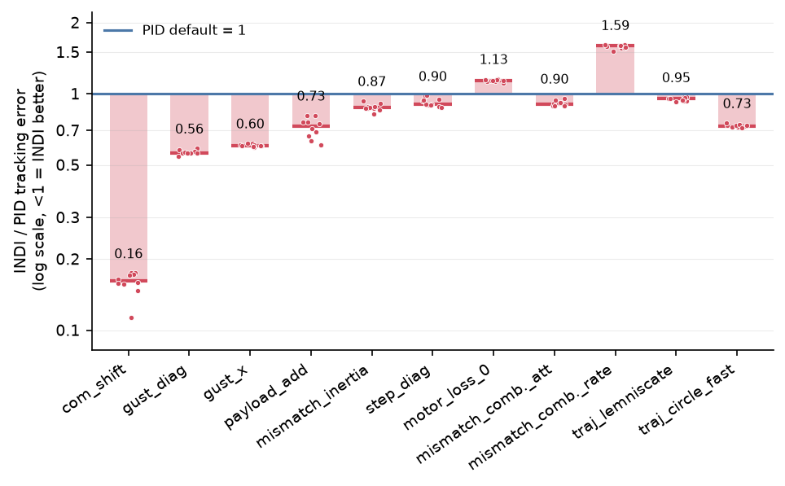
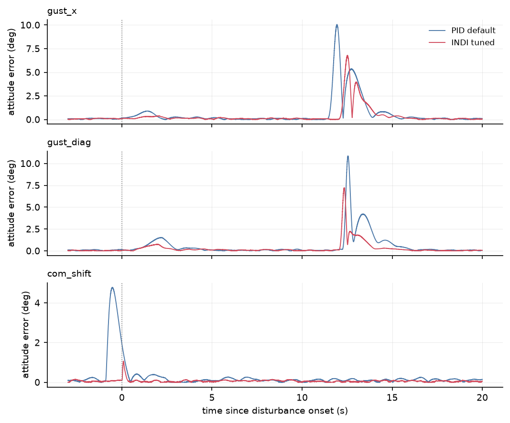
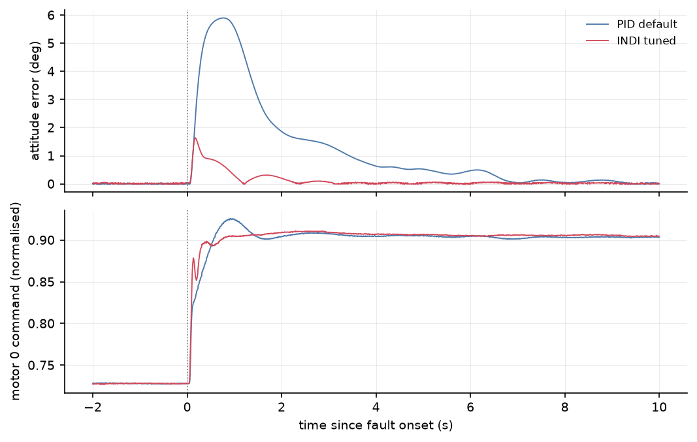
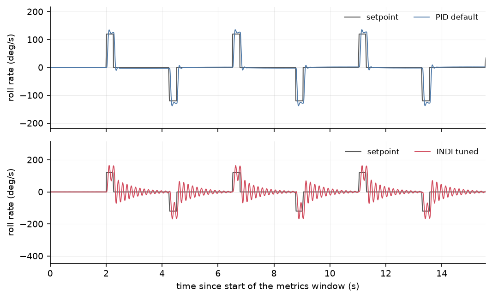
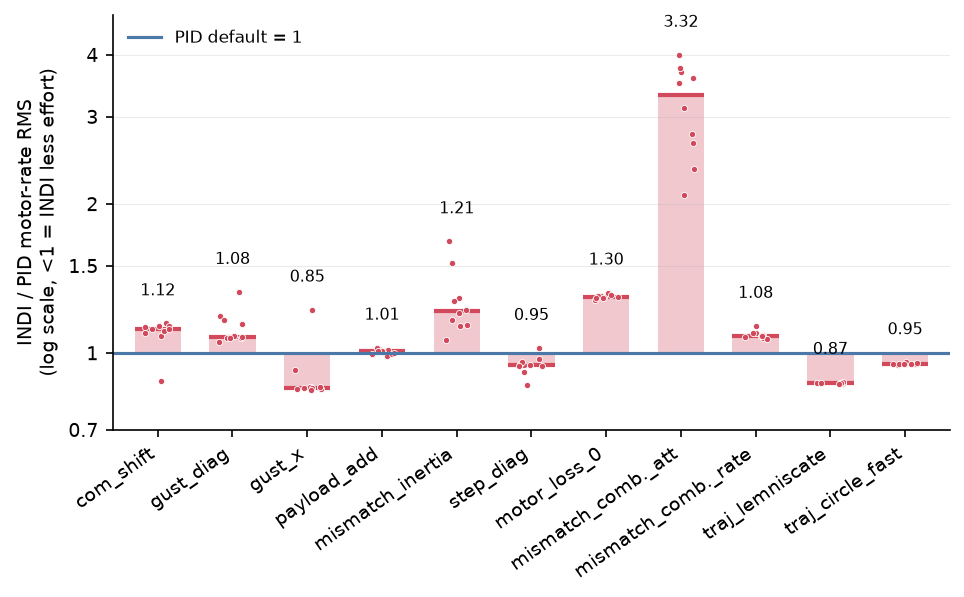

# 8. Results

## 8.1 Experimental protocol

**Plant and scenarios.** All flights are PX4 SITL with the Gazebo `gz_x500` model. Scenarios, metrics and the four acceptance criteria were frozen before any INDI code existed (`bench/scenarios.md`, v1, 2026-11-13). The tuning set is T1-T9 and the held-out set is H1-H6. Each H scenario is a variant of a T mechanism with different parameters (`bench/scenarios.md`, section 3.2). Held-out scenarios were never used to choose gains. Several T scenarios (T5-T9) also turned out not to be used for tuning in practice, because the simulator extensions they need did not exist when tuning ran (`bench/scenarios.md`, change log; `results/t8_motor_loss_s13.md`; `results/heldout_s15.md`).

**Controllers.**

| Label | What it is | Source |
|---|---|---|
| PID (`pid_default`) | PX4 defaults for `gz_x500`, untouched | `bench/scenarios.md` section 2 |
| INDI (`indi_tuned`) | Frozen candidate `results/tuning/indi/r4f/c00/params` (decision D-freeze) | `results/tuning/r4f.md` |

The spec also defines a `pid_tuned` baseline, against which the acceptance criteria are written. No retuned PID candidate beat the defaults: the best retuned PID scored J = 0.958 against 0.964 for the re-flown defaults, which is inside noise (40 candidates over rounds r1 and r2; `STATE.md`, session 10; `results/tuning/r2.md`). `acceptance_s15.md` therefore uses the PX4 defaults as `pid_tuned`. Parameters outside the rate and attitude loops (position control, estimator, allocator, failsafes) are identical for both controllers. Tuning is described in chapter 7 (`report/07_tuning.md`) and is not repeated here.

**Seeds and statistics.** Final validation uses 10 seeds per scenario and controller, with the same seed list for both (paired design; `bench/scenarios.md`, section 3.3). The seed varies simulator sensor noise, and gust onset and direction jitter where the scenario has them. It does not vary the trajectory start phase, which is a deviation from the spec (`bench/scenarios.md`, change log, session 15). For each scenario the test is a two-sided exact Wilcoxon signed-rank test on the per-seed differences of the primary metric, alpha = 0.05 (`bench/scenarios.md`, section 6; `bench/summarize_seeds.py`). With n = 10 the smallest attainable p-value is 0.00195 (printed as 0.002 in several tables), so p = 0.002 with "10/10" means INDI was better (or worse) on every seed. With n = 5 the smallest p would be 0.0625, and with n = 3 it would be 0.25 (arithmetic, not stated in the sources for n = 3). Tables below give mean ± std over seeds, the ratio INDI/PID, and "INDI lower" as the number of seeds on which INDI's value is smaller (lower is better for every error metric).

**Simulation speed.** Scenarios whose metrics depend on position run at real-time speed (factor 1). Attitude and rate scenarios run at factor 4, because factor 4 is equivalent to factor 1 for attitude and rate metrics but not for hover position RMS (0.027 m against 0.064 m; decision D-speed, `STATE.md` session summary). Concretely, H6 `step_diag` and T9 `mismatch_inertia` run at factor 4 (`results/heldout_s14.md`), H5 at factor 4 (`results/heldout_h5_s15.md`), and the disturbance, trajectory and hover scenarios at factor 1 (`results/heldout_s14.md`, `results/heldout_s15.md`).

**Primary metrics.** For the disturbance and diagonal-step scenarios the sources use the attitude rotation-angle RMS over the scenario window (`att rot rms`) as the primary metric. T1 uses position RMS, T4 and H5 rate pulses use roll-rate RMS, and trajectory scenarios use position RMS against the logged `trajectory_setpoint` (`bench/scenarios.md` change log v1.1; `results/heldout_s15.md`). Whole-window RMS values are used throughout; peak deviation and recovery time are reported only where the sources give them (T8 fault onset, position maximum deviation).

**Limits of the data.**

- Not every number comes from 10 seeds. T8 motor loss was first summarised on seeds 1-3 (`results/t8_motor_loss_s13.md`); its 10-seed values (`results/t8_motor_loss_10seeds_s26.md`, same firmware and parameters, seeds 4-10 flown in the same session) are used here. The tuning-set step scenarios in `results/tuning/r4f.md` use 3 seeds.
- Hover position RMS is noise-dominated: the same parameters and seeds gave hover scores of 0.77 and 1.31 in two batches, because of sporadic vertical excursions in both controller families (decision D-hovernoise, `STATE.md` session 13). Hover position results are therefore not used to rank the controllers.
- Position rows in attitude-mode and rate-mode scenarios (step_diag, mismatch_inertia, H5) are meaningless, since the vehicle drifts tens of metres without position hold. They are ignored, though they appear in the source tables (`results/heldout_s14.md`, `results/heldout_h5_s15.md`).
- The trajectory table computation was an inline script that is not yet in `bench/` (`results/heldout_s15.md`, TODO in that file).
- The simulator motor model, delay and noise are those of `gz_x500` with the extensions listed in `bench/scenarios.md`. All conclusions are simulation-only.

## 8.2 Acceptance verdict

**Outcome under the frozen rules: INDI does not outperform PID** (`results/acceptance_s15.md`). All six held-out scenarios were flown with 10 paired seeds each, using the frozen candidates. The spec's three possible outcomes (outperforms, matches, does not outperform) are all written up with the same rigour, and "matches" is available only if criteria 1 and 3 hold (`bench/scenarios.md`, section 6). Here criteria 1 and 3 both fail.

| # | Criterion (`bench/scenarios.md` section 6) | Result | Met? |
|---|---|---|---|
| 1 | No INDI run fails in any H or T scenario | INDI crashes on H4 on 10/10 seeds (PID also 10/10; the two behave alike until impact), but the criterion is stated for INDI alone and is applied as written | **No** |
| 2 | Significantly better (median improvement >= 10 % and p < 0.05) on at least 4 of 6 H scenarios | H1, H2, H3 clearly; H6 and the T2 part of H5 exactly at the 10 % threshold | Yes (marginally) |
| 3 | Not significantly worse by more than 10 % on any H scenario | H5 rate pulses: roll-rate RMS 1.58x PID, median improvement -58 %, p = 0.002, 0/10 seeds better | **No** |
| 4 | Hover motor-rate effort (T1) at most 1.5x `pid_tuned` | 0.0387 against 0.0371 /s, ratio 1.04, p = 0.16 | Yes |

Per held-out scenario, from `results/acceptance_s15.md`:

| H | Primary metric | INDI/PID | Median improvement | p | Verdict |
|---|---|---|---|---|---|
| H1 traj_circle_fast | position RMS | 0.73 | about 27 % | 0.002 | better, but the path is infeasible for both controllers |
| H2 gust_diag | attitude RMS | 0.57 | 44 % | 0.002 | better |
| H3 com_shift | attitude RMS | 0.16 | 84 % | 0.002 | better |
| H4 motor_loss_2 | position RMS | 1.15 | not given | 0.11 | not significant; both crash 10/10 |
| H5 mismatch_combined, T2 part | stepped-axis attitude RMS | 0.91 | 10 % | 0.002 | borderline better, with a 5-7 Hz limit cycle |
| H5 mismatch_combined, T4 part | roll-rate RMS during pulses | 1.58 | -58 % | 0.002 | **significantly worse** |
| H6 step_diag | attitude RMS | 0.92 | 10 % | 0.002 | borderline better (exactly at the threshold) |

(The H2 and H3 ratios come from `results/heldout_s14.md`; `acceptance_s15.md` leaves them blank.)

Two points about reading the verdict. First, criterion 2 counts H5 as one scenario but H5 has two parts with opposite outcomes, and the spec does not say how to combine them. Counting H5 as a win would be wrong given its limit cycle, and even without H5 the count of wins is H1, H2, H3, H6 = 4, at the threshold. Second, the verdict does not depend on H4: `acceptance_s15.md` states that even setting H4 aside as infeasible for both controllers, the outcome is unchanged, because criterion 3 fails on its own through H5.

Results against PID are summarised in the source as follows. INDI is much better at rejecting disturbance torques (27-84 % lower attitude RMS on H2, H3, T6 and T7, and 5.7x lower in the T8 fault window; the T8 whole-window RMS is 14 % worse because of the yaw step) and slightly better at tracking, but it is fragile to an error in its actuator model (motor time constant x2 gives a limit cycle), which PID tolerates (`results/acceptance_s15.md`). That trade-off is the main finding of this thesis.

## 8.3 Disturbance rejection

The disturbance scenarios test the mechanism INDI is expected to win on: a disturbance torque appears in the measured angular acceleration and is cancelled within one control increment, whereas PID has to wait for its integrator (`results/heldout_s14.md`). All rows below are 10 paired seeds, PID defaults against the frozen INDI candidate, exact two-sided Wilcoxon (`results/heldout_s14.md`, 120 flights, 0 failures). Scenarios: T6 `gust_x` (3 m/s steady wind plus a 6 m/s, 1 s gust), T7 `payload_add` (+25 % mass), H2 `gust_diag`, H3 `com_shift`, T9 `mismatch_inertia` (Ixx, Iyy x1.3, run on the T2 steps; a plant-mismatch scenario rather than a disturbance).

Figure 8.1 summarises the primary-metric ratios of every held-out and disturbance scenario of this chapter; the bars are medians of the per-seed ratios, so they can differ in the last digit from the ratios of means in the tables. It is generated by `bench/make_figures.py` (`figures/README.md`).

**Attitude rotation-angle RMS (primary metric), deg, mean ± std:**

| Scenario | PID | INDI | INDI/PID | INDI lower | Median impr. | p |
|---|---|---|---|---|---|---|
| T6 gust_x | 1.19 ± 0.007 | 0.717 ± 0.0096 | 0.60 | 10/10 | 40 % | 0.002 |
| H2 gust_diag | 1.05 ± 0.0091 | 0.593 ± 0.014 | 0.57 | 10/10 | 44 % | 0.002 |
| T7 payload_add | 0.0903 ± 0.0069 | 0.0646 ± 0.0052 | 0.72 | 10/10 | 27 % | 0.002 |
| H3 com_shift | 0.566 ± 0.063 | 0.0889 ± 0.0049 | 0.16 | 10/10 | 84 % | 0.002 |
| T9 mismatch_inertia | 3.33 ± 0.071 | 2.92 ± 0.069 | 0.88 | 10/10 | 13 % | 0.002 |

The absolute attitude errors on T7 and H3 are tenths of a degree or less, so the large ratios there describe small quantities. The largest gain is H3 on the roll axis (0.559 against 0.0719 deg, 0.13x; `results/heldout_s14.md`).

**Position metrics (horizontal RMS and 3D maximum deviation, m).** Position gains are much smaller than the attitude gains and are not significant for T7:

| Scenario | Metric | PID | INDI | INDI/PID | INDI lower | p |
|---|---|---|---|---|---|---|
| T6 gust_x | pos RMS horiz | 0.106 ± 0.0016 | 0.089 ± 0.0019 | 0.84 | 10/10 | 0.002 |
| T6 gust_x | pos max dev 3D | 0.602 ± 0.01 | 0.482 ± 0.013 | 0.80 | 10/10 | 0.002 |
| H2 gust_diag | pos RMS horiz | 0.107 ± 0.002 | 0.0955 ± 0.0025 | 0.89 | 10/10 | 0.002 |
| H2 gust_diag | pos max dev 3D | 0.438 ± 0.019 | 0.343 ± 0.016 | 0.78 | 10/10 | 0.002 |
| T7 payload_add | pos RMS horiz | 0.0187 ± 0.0022 | 0.0177 ± 0.0017 | 0.95 | 7/10 | 0.375 (n.s.) |
| T7 payload_add | pos max dev 3D | 0.354 ± 0.016 | 0.352 ± 0.0097 | 0.99 | 7/10 | 0.557 (n.s.) |
| H3 com_shift | pos RMS horiz | 0.0351 ± 0.0026 | 0.0183 ± 0.0013 | 0.52 | 10/10 | 0.002 |
| H3 com_shift | pos max dev 3D | 0.276 ± 0.014 | 0.227 ± 0.0044 | 0.82 | 10/10 | 0.002 |

For T9 the position rows are not meaningful (the vehicle is in attitude mode and drifts about 19 m RMS for both controllers) and are not tabulated.

**Yaw is the exception.** Yaw RMS (deg) on the same scenarios:

| Scenario | PID | INDI | INDI/PID | INDI lower | p |
|---|---|---|---|---|---|
| T6 gust_x | 0.0878 ± 0.031 | 0.0877 ± 0.022 | 1.00 | 4/10 | 1 (n.s.) |
| H2 gust_diag | 0.25 ± 0.027 | 0.109 ± 0.012 | 0.44 | 10/10 | 0.002 |
| T7 payload_add | 0.027 ± 0.0055 | 0.0302 ± 0.0035 | 1.12 | 2/10 | 0.131 (n.s.) |
| H3 com_shift | 0.0732 ± 0.009 | 0.0344 ± 0.0051 | 0.47 | 10/10 | 0.002 |
| T9 mismatch_inertia | 0.167 ± 0.068 | 0.138 ± 0.059 | 0.83 | 8/10 | 0.322 (n.s.) |

INDI is therefore equal or marginally worse in yaw on two of the five scenarios (neither difference significant) and better on the other three, of which two are significant. Yaw is a secondary metric and does not enter the acceptance criteria. The sources report yaw as INDI's weak axis whenever yaw is commanded (see section 8.4).

**Earlier 5-seed ratios.** The first batch (5 seeds; per-scenario values from `STATE.md`, session 14, the range 0.15-0.75x from `results/heldout_s14.md`, "Reading" section) gave slightly different ratios (com_shift 0.15x, gust_diag 0.57x, gust_x 0.61x, payload_add 0.75x). Those were superseded by the 10-seed values above. `STATE.md` still quotes the 5-seed figures in its session 14 entry.

**T8 motor loss (10 seeds).** T8 (motor 0 thrust x0.7 at runtime, then a +45 deg yaw step, attitude mode, speed 1) was not used in tuning. It was flown with 10 seeds per controller, 0 failures; the seed spread is negligible because the fault is deterministic and seeds change only sensor noise. Every difference below has the same sign on 10 of 10 seeds (exact paired Wilcoxon p = 0.002) (`results/t8_motor_loss_10seeds_s26.md`; seeds 1-3 first in `results/t8_motor_loss_s13.md`). Ranges over seeds 1-10 (whole window: mean ± standard deviation):

| Metric | PID | INDI |
|---|---|---|
| Rotation RMS, whole window (deg) | 9.06 ± 0.09 | 10.3 ± 0.05 |
| Roll RMS (deg) | 0.715 ± 0.001 | 0.082 ± 0.001 |
| Pitch RMS (deg) | 0.684 ± 0.002 | 0.155 ± 0.001 |
| Yaw RMS (deg) | 9.01 ± 0.09 | 10.3 ± 0.05 |
| Motor-rate RMS (/s) | 0.391 ± 0.003 | 0.508 ± 0.003 |
| Saturated fraction | 0.076 ± 0.001 | 0.121 ± 0.002 |
| Peak tilt error at fault onset (deg) | 5.11-5.16 | 1.61-1.64 |
| Attitude RMS in fault window (deg) | 1.116-1.121 | 0.194-0.199 |
| Saturation time in fault window (s) | 1.73-1.76 | 2.72-2.88 |
| Faulty motor at high limit (s) | 1.54-1.57 | 2.07-2.22 |

INDI holds roll and pitch 5-9x better than PID under the fault and has a 3.2x lower peak tilt at onset, but the whole-window rotation RMS is about 14 % worse because the window is dominated by the yaw step, which INDI tracks worse, and INDI saturates more (12 % against 7.5 % of the window) with about 1.3x the motor-rate effort. The sources have not separated how much of that saturation comes from the later yaw step and how much from holding roll and pitch with a weakened motor (`results/t8_motor_loss_s13.md`, "Open").

## 8.4 Setpoint tracking

**Tuning set (3 seeds, ratios to PID defaults).** The frozen INDI candidate "r4f" against PID on the tuning scenarios (`results/tuning/r4f.md`, 15 flights, 0 failures). These scenarios were used to choose INDI's gains, so they are not evidence of generalisation, and no significance test is given for them:

| Scenario | Metric ratio INDI/PID | Motor-rate effort ratio (min-max over seeds) |
|---|---|---|
| T1 hover | 0.945 | 0.99-1.03 |
| T2 step_roll | 0.878 | 1.16-1.26 |
| T2 step_pitch | 0.935 | 0.63-0.71 |
| T3 step_yaw | **1.096** | 1.11-1.15 |
| T4 rate_step_roll | 1.021 | 0.67 |
| Tuning cost J | 0.978 (PID 0.958-0.964) | - |

The tuning cost difference (0.978 against about 0.96) lies inside the hover-term noise of about 0.1, so on the tuning set the comparison is a tie under the frozen cost, not a win (`results/tuning/r4f.md`). The hover ratio of 0.945 is the noise-dominated position RMS and carries no weight. INDI tracks roll steps 12 % and pitch steps 7 % better, equals PID on rate pulses and is 10 % worse on yaw steps.

**Hover (T1, 10 seeds).** Attitude RMS 0.76x PID, lower on 10/10 seeds, p = 0.002. Motor-rate RMS 0.0387 against 0.0371 /s (1.04x, p = 0.16) (`results/acceptance_s15.md`, citing `results/hover_s15.log`). The 10-seed position RMS for hover is not reported in the source files read for this chapter.

**Diagonal steps (H6 `step_diag`, 10 seeds, simultaneous 20 deg roll and pitch steps, speed 4).** From `results/heldout_s14.md`:

| Metric | PID | INDI | INDI/PID | INDI lower | Median impr. | p |
|---|---|---|---|---|---|---|
| Attitude rotation RMS (deg) | 6.36 ± 0.14 | 5.83 ± 0.12 | 0.92 | 10/10 | 10 % | 0.002 |
| Roll RMS (deg) | 4.41 ± 0.11 | 3.85 ± 0.097 | 0.87 | 10/10 | 14 % | 0.002 |
| Pitch RMS (deg) | 4.5 ± 0.1 | 4.24 ± 0.086 | 0.94 | 9/10 | 7 % | 0.004 |
| **Yaw RMS (deg)** | 0.802 ± 0.02 | 1.05 ± 0.032 | **1.31** | 0/10 | -34 % | 0.002 |
| Motor-rate RMS (/s) | 1.28 ± 0.055 | 1.21 ± 0.028 | 0.94 | 9/10 | 5 % | 0.004 |

The 10 % median improvement on the primary metric is exactly the criterion 2 threshold, so H6 is borderline. The source notes the yaw loss does not count against criterion 3 because that criterion is evaluated on the primary metric. Position rows are meaningless in this scenario.

**Trajectories (10 seeds, speed 1, 60/60 runs completed).** Errors are measured against the logged `trajectory_setpoint`; att RMS is dominated by the commanded tilt and is not a pure rate-loop tracking error (`results/heldout_s15.md`).

| Scenario | Metric | PID | INDI | INDI/PID | INDI lower | p |
|---|---|---|---|---|---|---|
| T5 lemniscate | position RMS 3D (m) | 0.46 ± 0.0045 | 0.437 ± 0.0047 | 0.95 | 10/10 | 0.002 |
| T5 lemniscate | max deviation 3D (m) | 1.2 ± 0.026 | 1.3 ± 0.026 | **1.08** | 0/10 | 0.002 |
| T5 lemniscate | att RMS (deg) | 10.8 ± 0.017 | 7.89 ± 0.017 | 0.73 | 10/10 | 0.002 |
| T5 lemniscate | min altitude (m) | 5.03 ± 0.13 | 4.94 ± 0.029 | 0.98 | - | 0.23 |
| H1 circle fast | position RMS 3D (m) | 3.43 ± 0.042 | 2.51 ± 0.022 | 0.73 | 10/10 | 0.002 |
| H1 circle fast | max deviation 3D (m) | 8.07 ± 0.083 | 6.67 ± 0.078 | 0.83 | 10/10 | 0.002 |
| H1 circle fast | att RMS (deg) | 16.9 ± 0.059 | 15.3 ± 0.036 | 0.90 | 10/10 | 0.002 |
| H1 circle fast | min altitude (m), lower is worse | 4.0 ± 0.16 | 3.84 ± 0.031 | 0.96 | - | 0.006 |

On T5, INDI gains 5 % in position RMS but has an 8 % larger peak deviation, on every seed. The shared PX4 position controller dominates the error. On H1 the specified path needs about 52 deg of tilt, above the default `MPC_TILTMAX_AIR` of 45 deg, so it is infeasible for both controllers and errors are metres. INDI's 27 % lower position RMS there is presumably due to its faster attitude response using the tilt limit sooner, but this was not analysed (`results/heldout_s15.md`). Also, INDI flies lower on H1 (minimum altitude 3.84 against 4.0 m, p = 0.006), which is a loss on that row. H1 counts as a win under criterion 2, with the caveat that it is a comparison on an infeasible path.

**Yaw is worse whenever yaw is commanded.** Evidence from the sources: tuning step_yaw 1.096x (3 seeds), step_diag yaw 1.31x (10/10 seeds worse, p = 0.002), T8 yaw about 14 % worse (10/10 seeds, p = 0.002) (`results/tuning/r4f.md`, `results/heldout_s14.md`, `results/t8_motor_loss_10seeds_s26.md`). The sources attribute this to a structural effect: PID filters its yaw torque at 2 Hz by default, and for INDI to avoid a 5x motor-rate effort on yaw steps the yaw-rate error (setpoint included) must be filtered by `MC_INDI_YAW_CUT` (decision D-yawsp). With that filter no INDI yaw set tried in round 4 beat PID on the yaw step at acceptable effort (best 1.089x at 1.13x effort) (`STATE.md`, session 13; `results/tuning/r4.md` as quoted there). This is a trade between yaw tracking and yaw-path noise, not a gain-tuning accident, but it has been tested only inside this one filter structure.

## 8.5 Robustness to actuator-model mismatch (H5)

H5 `mismatch_combined` modifies the plant to Ixx, Iyy, Izz x0.8, mass x1.15 (2.3 kg) and motor time constants x2 (0.025 s up, 0.05 s down), with controllers unchanged. It is flown as two runs, the T2 step pattern and the T4 rate-pulse pattern, 10 seeds each at speed 4 (`results/heldout_h5_s15.md`). **INDI loses this scenario.**

Roll-rate RMS (rad/s), mean ± std over 10 seeds:

| Run | PID | INDI | INDI/PID | INDI lower |
|---|---|---|---|---|
| mismatch_combined_att (T2 pattern) | 0.0883 ± 0.0018 | 0.340 ± 0.039 | 3.86 | 0/10 |
| mismatch_combined_rate (T4 pattern, primary metric of T4) | 0.356 ± 0.004 | 0.562 ± 0.006 | 1.58 | 0/10 |

Other metrics (`results/heldout_h5_s15.md`):

| Run | Metric | PID | INDI | INDI/PID | INDI lower | p |
|---|---|---|---|---|---|---|
| att pattern | roll attitude RMS (deg) | 3.27 ± 0.077 | 2.97 ± 0.073 | 0.91 | 10/10 | 0.002 |
| att pattern | motor-rate RMS (/s) | 0.623 ± 0.094 | 1.92 ± 0.24 | **3.08** | 0/10 | 0.002 |
| rate pattern | roll attitude RMS (deg) | 17.7 ± 0.26 | 19.3 ± 0.62 | 1.09 | 0/10 | 0.002 |
| rate pattern | motor-rate RMS (/s) | 3.34 ± 0.037 | 3.64 ± 0.034 | 1.09 | 0/10 | 0.002 |
| rate pattern | saturated fraction | 0.0164 ± 0.00016 | 0.0338 ± 0.00085 | 2.06 | 0/10 | 0.002 |

The lower roll attitude RMS on the T2 pattern (0.91x) is misleading: the steps dominate that metric, while INDI carries a sustained roll oscillation. On the rate pattern INDI is worse in every roll metric. Off-axis, INDI is better on pitch and yaw (pitch 0.17x on the rate pattern, yaw 0.43x), but these are small quantities next to the roll loss.

**Diagnosis** (INDI only, seeds 1-2, diagnostic scenarios `diag_h5_*`, never used for tuning; `results/heldout_h5_s15.md`). Roll-rate standard deviation over the last 2 s of the level-hold segment:

| Plant | INDI `MC_INDI_ACT_TC` | Hover roll-rate std (rad/s) | Peak frequency |
|---|---|---|---|
| H5 combined, seed 1 | 0.0114 (frozen) | 0.256 | 6.5 Hz |
| PID on H5 combined, seed 1 | - | 0.001 | - |
| T9 inertia x1.3 | 0.0114 | 0.002 | - |
| inertia x0.8 and mass x1.15 only | 0.0114 | 0.002 | - |
| motor time constants x2 only | 0.0114 | 0.267 / 0.278 | 5.2 / 5.6 Hz |
| motor time constants x2 only | 0.0228 (matched x2) | 0.004 / 0.004 | - |

The motor lag mismatch alone produces the 5-7 Hz limit cycle. INDI builds its actuator-state estimate from a first-order model with time constant `MC_INDI_ACT_TC`. When the real motors are twice as slow, the modelled state leads the real one, the synchronisation between the actuator-state and angular-acceleration filters is broken, and at the frozen gain K_R of 23.9 rad/s the loop settles into a limit cycle. Inertia and mass errors scale only G1 and are tolerated. With `MC_INDI_ACT_TC` doubled to match the plant the oscillation vanishes, and the remaining extra rate error is due to the slower actuator itself. The matched-time-constant run is a diagnosis, not a retune; the held-out result remains the frozen-candidate result. PID has no actuator model and degrades gracefully. A robustness margin on `ACT_TC` or a lower K_R is a design trade that has not been evaluated, and the vehicle's motor time constant would have to be identified, or ESC RPM telemetry used, before relying on INDI on hardware (`results/heldout_h5_s15.md`).

Caveats: the diagnosis uses 2 seeds, one INDI parameter set and one mismatch factor (x2). Whether INDI would survive a smaller mismatch, or a mismatch in the other direction, is not tested in the sources.

Figure 8.6 shows the roll rate of both controllers on the H5 rate-pulse run, seed 1. A power spectrum of the level-hold segment and the `diag_h5_*` runs with matched `MC_INDI_ACT_TC` are not plotted; the 5-7 Hz peak frequencies in the diagnosis table come from `results/heldout_h5_s15.md`.

## 8.6 Double failure (H4)

H4 `motor_loss_2` applies motor 2 thrust x0.6 from the start of the T5 lemniscate path (path acceleration 6.6 m/s^2). As specified and frozen, this is beyond what the x500 can deliver with either controller (`results/heldout_s15.md`). **Both controllers crash on 10/10 seeds** (ground contact, altitude below 0.3 m). Under criterion 1 this counts as an INDI failure, since the criterion is written for INDI alone. PID seed 1 also touched the ground in the earlier harness check (`bench/scenarios.md`, change log).

Up to first ground contact (inline script, session 15):

| | PID | INDI |
|---|---|---|
| Time from fault to ground contact, seeds 1-10 (s) | 7.1-7.2 (7.2 on all but one) | 7.3-7.6 (mean 7.45) |
| Max tilt before contact (deg) | 17 on every seed | 18-23 (18 on 6 seeds) |

Whole-window metrics (these include post-impact samples, so they describe the crash and not the control):

| Metric | PID | INDI | INDI/PID | INDI lower | p |
|---|---|---|---|---|---|
| Position RMS 3D (m) | 4.35 ± 0.24 | 5.01 ± 1.0 | 1.15 | 3/10 | 0.11 |
| Attitude RMS (deg) | 38.6 ± 25 | 69.3 ± 22 | 1.80 | 1/10 | 0.010 |
| Peak tilt error (deg) | 32.1 ± 7.9 | 111 ± 56 | 3.46 | 1/10 | 0.004 |
| Saturation time (s) | 8.86 ± 2.7 | 8.97 ± 1.6 | 1.01 | 4/10 | 0.85 |

Read literally, the whole-window attitude and peak-tilt metrics are significantly worse for INDI. The source argues that INDI's large tilt errors (above 90 deg) all occur after impact on the ground, and that in flight the two controllers fail in the same way, INDI staying airborne about 0.3 s longer (`results/heldout_s15.md`). That reading comes from an inline script on `vehicle_local_position` and `vehicle_attitude` and has not been moved into `bench/`. The metrics window should end at ground contact for scenarios that can crash; that change to `metrics.py` is listed as to-do in the source and had not been made. H4 is therefore a draw in substance, but the record still shows a formal loss on criterion 1. Note also that `bench/scenarios.md` does not list a primary metric for H4, and `acceptance_s15.md` uses position RMS.

## 8.7 Control effort and saturation

Effort is measured as the RMS of the time derivative of the `actuator_motors` outputs (noise transmission, "motor-rate RMS") and as the fraction of the window with any motor at or beyond 0.99 or 0.01 (`bench/scenarios.md`, section 4). Criterion 4 limits hover motor-rate effort to 1.5x PID; INDI measures 1.04x (0.0387 against 0.0371 /s, p = 0.16), so criterion 4 passes (`results/acceptance_s15.md`).

Figure 8.8 shows the effort ratios for all scenarios. The trajectory scenarios (traj_lemniscate, traj_circle_fast) have no effort reference table in `results/`; their bars are computed by `bench/make_figures.py` from the run metrics and were not cross-checked against a second source.

This was not true of the first INDI versions. `STATE.md` records that untuned INDI v0 had 8x PID's hover effort, all from the yaw path (yaw angular-acceleration noise passed to torque with gain 1/G1_Y). It was brought to about 1.1x through a yaw-path filter, a filter on the yaw rate in the error term, and filtering of the setpoint (decisions D-yawfilt, D-yawnu, D-yawsp; `STATE.md`, sessions 7-13). Those fixes are one source of INDI's weaker yaw tracking (section 8.4).

Motor-rate effort ratio INDI/PID across scenarios (10 seeds unless noted; ratio above 1 is worse for INDI):

| Scenario | Ratio | INDI lower | p | Source |
|---|---|---|---|---|
| T1 hover | 1.04 | - | 0.16 | `results/acceptance_s15.md` |
| T2 step_roll (3 seeds) | 1.16-1.26 | - | - | `results/tuning/r4f.md` |
| T2 step_pitch (3 seeds) | 0.63-0.71 | - | - | `results/tuning/r4f.md` |
| T3 step_yaw (3 seeds) | 1.11-1.15 | - | - | `results/tuning/r4f.md` |
| T4 rate_step_roll (3 seeds) | 0.67 | - | - | `results/tuning/r4f.md` |
| T6 gust_x | 0.89 | 9/10 | 0.084 | `results/heldout_s14.md` |
| T7 payload_add | 1.01 | 4/10 | 0.193 | `results/heldout_s14.md` |
| H2 gust_diag | 1.13 | 0/10 | 0.002 | `results/heldout_s14.md` |
| H3 com_shift | 1.09 | 1/10 | 0.084 | `results/heldout_s14.md` |
| H6 step_diag | 0.94 | 9/10 | 0.004 | `results/heldout_s14.md` |
| T9 mismatch_inertia | 1.27 | 0/10 | 0.002 | `results/heldout_s14.md` |
| H5 att pattern | 3.08 | 0/10 | 0.002 | `results/heldout_h5_s15.md` |
| H5 rate pattern | 1.09 | 0/10 | 0.002 | `results/heldout_h5_s15.md` |
| T8 motor loss (10 seeds) | 1.30 | 0/10 | 0.002 | `results/t8_motor_loss_10seeds_s26.md` |

INDI uses significantly more effort on H2 (1.13x), T9 (1.27x) and H5 (3.08x and 1.09x), and significantly less on H6 (0.94x). Only H5 approaches or exceeds the 1.5x hover limit, and criterion 4 is defined for hover only. The H5 result is the limit cycle of section 8.5.

Saturation (fraction of window with a motor at a limit, or time saturated):

| Scenario | PID | INDI | Note |
|---|---|---|---|
| Most disturbance scenarios (T6, T7, H2, H3, T9, H5 att pattern) | 0 | 0 | `results/heldout_s14.md`, `results/heldout_h5_s15.md` |
| H6 step_diag | 0.000143 ± 0.00031 | 0.0000864 ± 0.00019 | negligible, p = 1 |
| T8 motor loss | 0.076 ± 0.001 | 0.121 ± 0.002 | 10 seeds, 0/10 lower, p = 0.002; INDI saturates more |
| H5 rate pattern | 0.0164 | 0.0338 | 2.06x, p = 0.002 |
| H4 motor_loss_2 (time, s) | 8.86 ± 2.7 | 8.97 ± 1.6 | crash scenario, p = 0.85 |

Saturation is therefore a non-issue on most scenarios but INDI saturates more than PID on both of the scenarios where the plant is degraded (T8, H5 rate pulses). No scenario shows INDI saturating less. The benchmark spec also asks for the `control_allocator_status` unallocated torque; the sources do not report it.

## 8.8 Summary of all scenarios

Primary-metric ratio INDI/PID (below 1 favours INDI) and verdict. "n" is the number of paired seeds. Where a source reports no p-value, the cell is empty.

| ID | Scenario | n | Primary metric | INDI/PID | INDI lower | p | Verdict | Source |
|---|---|---|---|---|---|---|---|---|
| T1 | hover | 10 | attitude RMS (the T1 primary metric, position RMS, is noise-dominated) | 0.76 | 10/10 | 0.002 | no primary-metric result (position RMS noise-dominated); attitude RMS 0.76x, secondary; effort 1.04x | `acceptance_s15.md` |
| T2 | step_roll | 3 | stepped-axis attitude RMS | 0.878 | - | - | INDI better, tuning set | `tuning/r4f.md` |
| T2 | step_pitch | 3 | stepped-axis attitude RMS | 0.935 | - | - | INDI better, tuning set | `tuning/r4f.md` |
| T3 | step_yaw | 3 | yaw attitude RMS | 1.096 | - | - | **INDI worse**, tuning set | `tuning/r4f.md` |
| T4 | rate_step_roll | 3 | roll-rate RMS | 1.021 | - | - | tie, tuning set | `tuning/r4f.md` |
| T5 | traj_lemniscate | 10 | position RMS 3D | 0.95 | 10/10 | 0.002 | small INDI gain; max deviation 1.08x (worse) | `heldout_s15.md` |
| T6 | gust_x | 10 | attitude RMS | 0.60 | 10/10 | 0.002 | INDI better | `heldout_s14.md` |
| T7 | payload_add | 10 | attitude RMS | 0.72 | 10/10 | 0.002 | INDI better (small absolute values) | `heldout_s14.md` |
| T8 | motor_loss_0 | 10 | fault-window attitude RMS | 0.18 (0.197 against 1.118 deg) | 10/10 | 0.002 | INDI better at onset; whole-window rotation RMS 1.14x (worse, yaw, 0/10) | `t8_motor_loss_10seeds_s26.md` |
| T9 | mismatch_inertia | 10 | attitude RMS | 0.88 | 10/10 | 0.002 | INDI better; effort 1.27x | `heldout_s14.md` |
| H1 | traj_circle_fast | 10 | position RMS 3D | 0.73 | 10/10 | 0.002 | INDI better, path infeasible for both | `heldout_s15.md` |
| H2 | gust_diag | 10 | attitude RMS | 0.57 | 10/10 | 0.002 | INDI better; effort 1.13x | `heldout_s14.md` |
| H3 | com_shift | 10 | attitude RMS | 0.16 | 10/10 | 0.002 | INDI better | `heldout_s14.md` |
| H4 | motor_loss_2 | 10 | position RMS 3D | 1.15 | 3/10 | 0.11 | both crash 10/10; formal criterion 1 failure | `heldout_s15.md` |
| H5 | mismatch_combined, T2 part | 10 | stepped-axis attitude RMS | 0.91 | 10/10 | 0.002 | borderline better, but limit cycle, effort 3.08x | `heldout_h5_s15.md` |
| H5 | mismatch_combined, T4 part | 10 | roll-rate RMS | 1.58 | 0/10 | 0.002 | **INDI significantly worse** | `heldout_h5_s15.md` |
| H6 | step_diag | 10 | attitude RMS | 0.92 | 10/10 | 0.002 | borderline better; yaw 1.31x worse | `heldout_s14.md` |

The T8 ratio of 0.18 is the ratio of the 10-seed means in `results/t8_motor_loss_10seeds_s26.md` (0.197/1.118), equivalently "5.7x lower" for attitude RMS in the fault window.

**Overall reading.** INDI has a clear and statistically solid advantage on disturbance torques (T6, T7, H2, H3, T8 at onset) in attitude, a smaller advantage in position, and about parity on nominal tracking. It loses on yaw whenever yaw is commanded, it has a larger peak deviation on the lemniscate, it saturates more under degraded actuators, and it is fragile to a wrong actuator time constant (H5), which PID tolerates. Under the rules fixed before INDI flew, that is "INDI does not outperform PID".

**Not available in the sources used for this chapter:** 10-seed results for T2, T3 and T4 (only the 3-seed tuning-set values), the 10-seed hover position RMS, peak deviation and recovery-time metrics for T6, T7, H2 and H3 (the sources report RMS and position maximum deviation), and any comparison against a separately retuned `pid_tuned` (it equals the defaults). A p-value cannot be given for T8.
