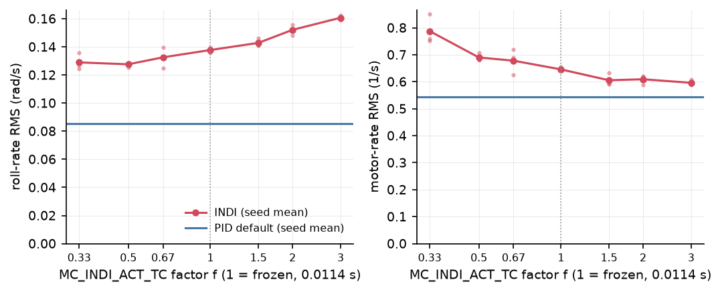

# 9 Discussion

This chapter interprets the results of chapter 8 and states what they do and do not support. It does not repeat the tables. The verdict under the acceptance rules frozen before INDI flew is "INDI does not outperform PID" (`results/acceptance_s15.md`). The chapter explains why that verdict coexists with a clear INDI advantage in disturbance rejection, treats the actuator-model weakness (H5) as the main finding, explains why yaw parity is structural, lists the limits of the evidence, and lists what would have to be done before any real flight.

## 9.1 Interpretation

**Why INDI rejects disturbance torques better.** The incremental law of chapter 5 computes a torque increment from the measured angular acceleration. An unmodelled torque, whether from a shifted centre of mass, a gust acting through a centre of pressure, or an inertia error, changes the measured acceleration within one controller cycle, and the next increment compensates it. The law needs no model of the disturbance, only the effectiveness G1 and a correct estimate of what the actuators are already doing. The PID rate loop has no such measurement. It reacts to the resulting rate error, and a constant torque offset is removed only as fast as its integrator accumulates. The data are consistent with this picture. The attitude RMS ratio INDI/PID is 0.16 on the centre-of-mass shift (H3), 0.57 and 0.60 on the two gust scenarios (H2, T6), and 0.72 on payload addition (T7), lower on 10 of 10 seeds in each case (`results/heldout_s14.md`). On T8 the peak tilt error at the onset of the motor fault is 1.6 deg for INDI against 5.1 deg for PID, with 3 seeds (`results/t8_motor_loss_s13.md`).

Two readings of the ordering are offered as interpretation, not as tested claims. First, the largest gain is on the scenario whose disturbance is a constant torque offset (H3, roll 0.13x), which is the case where a PID integrator is slowest relative to a direct measurement. Time-varying gusts give a smaller gain. Second, the position gains are much smaller than the attitude gains (horizontal position RMS ratio 0.84 on T6, 0.89 on H2, none significant on T7). Both controllers share the PX4 position loop, and the disturbance forces act on position regardless of attitude. No ablation was run that would isolate the mechanism, for example a PID with a retuned integrator or a disturbance feed-forward, so the explanation rests on the control-theoretic argument and the consistency of the results, not on a controlled experiment.

**Size of the effect in absolute terms.** The attitude errors on T7 and H3 are tenths of a degree or less for both controllers (T7: 0.090 against 0.065 deg; H3: 0.566 against 0.089 deg). A ratio of 0.16 describes a small quantity. Whether it matters depends on the application. For a gimbal-free survey platform a 0.5 deg transient is probably irrelevant, while for a vehicle with a large lever arm or a tight position requirement it could matter. The position metrics, which are closer to a mission-level quantity, show smaller gains (H3 horizontal RMS 0.52x, T7 not significant).

**Why a clear advantage still counts as a loss.** The acceptance rules were written before INDI existed and were applied as written (decision D-accept, `DECISIONS.md`). They are a conjunction of conditions: no INDI run may fail (criterion 1), and no held-out scenario may be significantly worse by more than 10 % (criterion 3), in addition to the requirement of wins on at least 4 of 6 held-out scenarios (criterion 2). A conjunction of "no worse anywhere" conditions penalises a controller with one sharp weakness, however large its strengths elsewhere. Here criterion 3 fails on H5 (roll-rate RMS 1.58x, 0 of 10 seeds better), and criterion 1 fails on H4, where both controllers crash on 10 of 10 seeds. Criterion 2 is met only marginally: H1, H2 and H3 are clear, while H6 and the T2 part of H5 sit exactly at the 10 % threshold, and H1 is a comparison on a path that is infeasible for both controllers (`results/acceptance_s15.md`, `results/heldout_s15.md`). The spec allows "matches" only if criteria 1 and 3 hold, so that outcome is also unavailable.

Two rule changes were considered and rejected as after-the-fact: averaging the two parts of H5, and excluding H4 as infeasible. Neither would change the outcome, because criterion 3 fails on H5 alone (D-accept). The verdict should therefore be read as precisely what it says: INDI did not satisfy a strict no-regression standard. It is not a finding that INDI is the worse controller on average. The honest summary is a trade. INDI has a large, statistically solid advantage against disturbance torques. It is about equal on nominal tracking: the tuning-set cost is 0.978 against about 0.96, which is inside the hover noise of about 0.1 (`results/tuning/r4f.md`, D-hovernoise), roll steps are 12 % better and yaw steps 10 % worse. And it has a specific, severe vulnerability to a wrong actuator model.

**A caveat on how fair the disturbance comparison is.** The tuning cost did not include any disturbance scenario. T5 to T9 were not used in tuning in the documented rounds (`report/07_tuning.md`, section 7.6), for either controller. The PID defaults were therefore not tuned for disturbance rejection, and neither was INDI. A PID with a higher integral gain, found by a search that included gust and shift scenarios, might narrow the gap. The sources do not test this. The scenario spec says both controllers would be re-tuned on the full T set once T5 to T9 existed, but no such round appears in the sources read [TO VERIFY: whether a full-T re-tune was ever run; chapter 7 lists it as unverified].

## 9.2 Actuator-model sensitivity

**The finding.** On H5 (inertia x0.8, mass x1.15, motor time constants x2) the frozen INDI candidate develops a 5 to 7 Hz roll limit cycle. Roll-rate RMS is 3.86x PID on the step pattern and 1.58x on the rate-pulse pattern, motor-rate effort is 3.08x PID on the step pattern, and the saturated fraction on the rate pattern doubles (`results/heldout_h5_s15.md`). The diagnostic runs isolate the cause to the motor lag: motor time constants x2 alone give a hover roll-rate standard deviation of about 0.27 rad/s at 5 to 6 Hz, whereas inertia and mass errors alone give 0.002 rad/s, the same as the T9 inertia case. When `MC_INDI_ACT_TC` is doubled to match the changed plant, the oscillation disappears (0.004 rad/s). The PID, which has no actuator model, shows 0.001 rad/s on the combined mismatch. This is the main robustness weakness of the INDI controller as implemented here. It is also the reason the verdict is a loss.

**Mechanism.** The explanation in the source is that INDI builds its actuator-state estimate from a first-order model with time constant `MC_INDI_ACT_TC`. If the real motors are slower, the modelled state leads the real one, the pairing between the actuator-state and angular-acceleration filters that the incremental law relies on no longer holds, and at the frozen rate gain K_R of 23.9 rad/s the loop settles into a limit cycle (`results/heldout_h5_s15.md`). This is consistent with the matched-time-constant experiment and with the literature's statement that actuator dynamics must be known or measured. It has not been confirmed by a stability analysis or by a frequency-domain check of the loop with a mismatched lag, so it should be taken as a well-supported diagnosis, not a proof. Inertia and mass errors scale only G1 and are tolerated, which agrees with the argument that the increment form is insensitive to moderate effectiveness errors.

**A candidate mechanism from a linear analysis.** The independent control-law review (`review/control_law_review_s16.md`, section 5; derived from the code structure, not reproduced numerically) makes the diagnosis more precise. With the filtered actuator-state estimate built from a first-order model `A_est` and the measured acceleration produced by the true actuator `A_true`, the increment law reduces to `u = (K/G1) e / (1 - H (A_est - A_true))`. With a matched model this is a plain proportional law on the rate error and the loop is `K A_true / s`. The mismatch term `A_est - A_true = (tau_t - tau_e) s / ((tau_e s + 1)(tau_t s + 1))`, with `tau_t` the true and `tau_e` the modelled time constant, is a band-pass centred at `f* = 1/(2 pi sqrt(tau_e tau_t))`. When the plant is slower than the model (`tau_t > tau_e`) it raises the effective gain near `f*`; for the H5 plant this band is 5-9 Hz, which is the observed oscillation band, and it lies below the 30 Hz synchronisation filters H, which therefore neither cause nor suppress it. Together with the extra actuator phase lag and the pipeline delay, the phase margin near the roughly 3 Hz crossover collapses, and the plant saturations (increment clamp, allocator, asymmetric motor constants) turn the instability into a bounded limit cycle. The same analysis explains the `MC_INDI_ACT_TC` sweep below: a model slower than the plant gives a negative mismatch term, which is a gain reduction (sluggish but safe), and a model three times faster than the plant puts `f*` near 14 Hz, far above crossover, where the boost is small. The dangerous case is specifically a plant slower than the model with `f*` near crossover. This is an analysis, not a measured loop transfer function, and it should be read as the most likely mechanism.

**What the test does not cover.** The diagnosis used 2 seeds, one INDI parameter set and one mismatch factor, in one direction (motors slower). The tolerance to a mismatch of x1.5, or of x0.5 (motors faster than modelled), is unknown. The frozen `MC_INDI_ACT_TC` is 0.0114 s, a value selected in tuning round r3 (`DECISIONS.md` D-freeze), and the simulator motor constants are 0.0125 s up and 0.025 s down (`timeConstantUp`/`timeConstantDown` in `Tools/simulation/gz/models/x500/model.sdf`, checked in session 17). A post-acceptance sweep that scaled `MC_INDI_ACT_TC` from 0.33x to 3x on the stock plant produced no limit cycle at any setting: roll-rate RMS moved only from 0.129 to 0.161 rad/s (`results/act_tc_sweep_s17.md`, 3 seeds per setting; Figure 9.1). So a mis-set actuator model on a fast actuator is benign here, and the H5 instability needs a physically slower actuator that the model does not know about. A sweep of the plant time constant itself, which would map the real stability boundary, was not run. A single time constant therefore stands for an asymmetric motor, and the nominal plant already carries some mismatch that the controller tolerates. The x2 test is a stress case of unknown severity relative to real hardware spread.

**What it means for a real vehicle.** ESC firmware, motor, propeller and battery combinations differ, and the time constant of the thrust response is rarely known to a factor better than 2. It also depends on the operating point and on ESC braking settings. A PX4 user cannot be asked to tune `MC_INDI_ACT_TC` per airframe by trial in flight, since a wrong value can excite an oscillation at several hertz, as H5 shows. Under the present design, INDI therefore moves the burden from "tune three PID gains" to "know the actuator lag". For the x500 in simulation the burden is low, because the model is known and fixed.

**Possible remedies (future work, none tested here).**

- *Measured rotor speed.* Using ESC RPM telemetry as the actuator state would remove the need for the model. The Tal and Karaman work cited in the research notes uses measured motor speed (`research/sources.md`, tal2021). In Gazebo `esc_status.esc_rpm` only echoes the command (`STATE.md`, integration facts), so this cannot be tested in the present simulator. The PX4 SIH simulator has a first-order motor lag and a modelled `esc_rpm` (`STATE.md`, session 9) and might be used for a first test. Real ESC telemetry rate, latency and resolution would also have to be checked.
- *Online identification* of the actuator time constant and of G1, in the manner of adaptive INDI (Smeur et al. 2016, `research/sources.md`, smeur2016). It adds a state that can itself misbehave, and it needs excitation that the vehicle may not have in hover.
- *Lower gains or a margin on the time constant.* The source suggests a robustness margin on `ACT_TC` or a lower K_R as an unevaluated trade. A lower K_R would reduce the bandwidth that gives INDI its advantage, so the cost of robustness would have to be measured on the disturbance scenarios.
- *Supervision.* Detecting a sustained oscillation and falling back to the PID is a plausible safeguard. It is a suggestion of this report and has no support in the sources.

## 9.3 Yaw

**What was observed.** INDI is worse than PID wherever yaw is commanded: 1.096x on the step_yaw tuning scenario (3 seeds), 1.31x on the H6 diagonal steps with 0 of 10 seeds better, and about 14 % on the whole-window rotation RMS of T8 (3 seeds, dominated by the yaw step) (`results/tuning/r4f.md`, `results/heldout_s14.md`, `results/t8_motor_loss_s13.md`). Where yaw is disturbed but not commanded, INDI is better or equal: 0.44x on H2 and 0.47x on H3 with 10 of 10 seeds, 1.00x on T6 and 1.12x on T7, neither significant (`results/heldout_s14.md`). Yaw is not part of the acceptance criteria, which are evaluated on the primary metric.

**Why the parity is structural.** Yaw torque in a multicopter comes from rotor drag, not from thrust differences times a lever arm. Its authority is small and slow. The G1 values used in the frozen candidate are 241 for roll and pitch and 7.4 for yaw (`report/07_tuning.md`, section 7.5), a ratio of about 33. Two consequences follow.

1. The yaw increment is the angular-acceleration error divided by G1_Y. The noise of the filtered yaw acceleration is therefore multiplied by a large gain. The first INDI version had about 8 times the hover motor-rate effort of PID, entirely from the yaw path, with spectral content around 35 Hz (`results/sync_check_v0.md`; `STATE.md`). The identified G1_Y of 7.4, replacing an earlier value of 30, made that noise gain 4 times larger still (`results/sync_check_v0.md`). Yaw acceleration has a poor signal-to-noise ratio, so a filter is unavoidable.
2. The filters needed to bring effort down also remove the bandwidth. The sources introduce a low-pass on the synchronised yaw acceleration and torque pair (D-yawfilt), on the yaw rate used in the error (D-yawnu), and finally on the yaw rate error including the setpoint (D-yawsp). The last was motivated by the measured step_yaw effort of about 5x PID, caused by the unfiltered setpoint step passing through K_Y/G1_Y. PID smooths the same step with its default 2 Hz yaw output filter (`DECISIONS.md`, D-yawsp). The decision gives INDI the same structure PID already has. It was not an advantage offered to INDI alone, but it is also what makes the yaw loop of INDI "a P-type rate loop behind a filter at about 1.5 to 2 Hz", in the words of `results/tuning/r4.md`.

Round 4 swept only the three yaw parameters (12 candidates, 3 seeds, selection rule fixed before the results). The tracking and effort frontier it found is: a ratio of 0.98 to PID needs 3.8x the effort, and at effort at most 1.25x the best ratio is 1.05 to 1.09 (`results/tuning/r4.md`). The frozen set (c10) is 1.089 at effort 1.13 to 1.14. With the filter in place INDI's yaw inversion through a weak and slow G1_Y has little to gain, and near-parity or slight inferiority is the expected result.

**Limits of this explanation.** The claim "no gain setting recovers PID-level yaw tracking" was tested inside one filter structure only. Another structure, for example a yaw-specific feed-forward, a notch instead of a low-pass, or a model with an identified rotor spin-up term G2, was not tried. G2 was not identifiable from the data (`results/sync_check_v0.md`: G2 0.05 with R^2 unchanged), and the yaw fit has R^2 of about 0.5. The explanation of the two worst candidates in round 4 as a lag-limited yaw oscillation was not checked on the logs (`results/tuning/r4.md`). A related model mismatch is noted in `STATE.md`: PX4 `CA_ROTOR_KM` is 0.05 whereas the Gazebo moment constant is 0.016 [TO VERIFY: whether this mismatch affects the yaw G1 identification or the PID baseline]. The yaw result is also specific to the x500, whose yaw authority depends on its propellers.

## 9.4 Limitations of the evidence

**Single simulated airframe.** Everything comes from one model, `gz_x500`, with G1 identified at a loop rate of 250 Hz on that model (`report/05_design_implementation.md`, section 5.7). Nothing here shows how the results would transfer to a larger vehicle, a different motor and propeller combination, or an airframe with lower stiffness. The H5 finding suggests that transfer cannot be assumed.

**Motor and sensor models.** The Gazebo model has a first-order motor lag with different up and down constants, which H5 modifies (`results/heldout_h5_s15.md`). It does not provide a measured rotor speed: `esc_rpm` echoes the command, so INDI uses an onboard model (`STATE.md`). Whether the thrust-to-speed relation, ESC dead time, battery sag and propeller inflow are representative of hardware is not established. The scenario spec required a fidelity document covering motor constants, IMU noise and bias, gyro rate and latency, and body drag before the disturbance and held-out scenarios were run (`bench/scenarios.md`, section 7). That document was written only after the benchmark had been flown (`bench/sim_fidelity.md`, session 17). It records a 250 Hz IMU with white gyro noise of 0.05 deg/s per axis and no bias, drift or vibration, and it leaves SITL latency uncharacterised. The report's conclusions on noise transmission, for instance the yaw acceleration noise, depend on that model. The disturbance injector is also a simplification: drag ignores vehicle velocity and rotor inflow, and the payload adds weight but not inertial mass (`DECISIONS.md`, D-dist). There is no battery model, so no voltage-dependent effectiveness (`report/05_design_implementation.md`, section 5.7).

**Simulation speed.** Attitude and rate scenarios (T9, H5, H6) ran at speed factor 4, and position-based ones at factor 1. The justification is a check on PID defaults, seeds 1 to 3: attitude and rate metrics agree within the seed spread, while hover position RMS does not (0.027 m against 0.064 m) (`DECISIONS.md`, D-speed). The cause is open, and the check was not repeated for INDI. A post-acceptance check repeated it for the frozen INDI candidate on H6 `step_diag` and H5 `mismatch_combined_rate`, seeds 1 to 3 (`results/speedcheck_indi_s22.md`). Rate-tracking and effort metrics agree within 4 % per seed, and the H5 limit cycle and its loss are unchanged at speed 1. The H6 attitude RMS, however, is 4 % higher on average at speed 1 (up to 7 %), which is half of INDI's 8 % H6 margin over PID; PID re-flown on H6 at speed 1 changes by less than 0.2 %, so the INDI/PID ratio on these three seeds moves from 0.874-0.904 at speed 4 to 0.881-0.973 at speed 1: INDI is still better on every seed, with a smaller margin. Only INDI is sensitive to the speed factor; the cause was not identified, and a timing effect on the angular-acceleration path is the most likely candidate. H6 was already at the acceptance threshold, and this check weakens it further. The speed-1 runs also include the post-freeze fixes, and n = 3.

**Hover metric noise.** Identical parameters and seeds gave hover scores between 0.77 and 1.31 in different batches, caused by sporadic vertical excursions in both controller families (`DECISIONS.md`, D-hovernoise; `results/tuning/r4.md`). Hover position RMS was therefore not used to rank controllers, and J differences below about 0.1 were treated as noise. The consequence for tuning is that the hover term gave almost no information, so the tuning decided effectively on four step scenarios.

**The PID baseline.** The baseline is the PX4 default parameter set for `gz_x500`. The sources report that no retuned PID beat it, with a best retuned J of 0.958 against 0.964 for the re-flown defaults. The search covered 40 candidates (24 in r1 with 2 seeds, 16 in r2 with 3 seeds, about 480 flights; `results/tuning/pid/r{1,2}/summary.csv`). In either case the search was random sampling in a 12-dimensional box, which shows that the defaults are hard to beat that way, not that they are optimal. A PID candidate that improved roll and pitch steps at a cost on yaw was seen (`results/tuning/r2.md`, via chapter 7).

**Budget asymmetry.** PID received two rounds (480 flights). INDI received four rounds (about 792 to 852 flights, depending on the source), plus three structural changes motivated by tuning-set effort (D-yawfilt, D-yawnu, D-yawsp). The spec asks for equal budgets. PID stopped early because the defaults won. The asymmetry favours INDI in tuning effort, but INDI's structural changes were also fixes of a defect that PID did not have, so the direction of the net bias cannot be stated from the data. No equivalent structural search was done on the PID side, for example on its D-term filtering (`report/07_tuning.md`, section 7.6).

**Size and independence of the held-out set.** There are six held-out scenarios, each with 10 seeds. The seeds vary sensor noise, and gust onset and direction where the scenario has them. They do not vary the trajectory start phase, which deviates from the spec (`bench/scenarios.md`, change log, session 15). The plant and the scenario are otherwise deterministic, so the seed spread is very small (for instance 0.0096 deg on a mean of 0.717) and a p-value of 0.002 is the floor of the test with n = 10 (`report/08_results.md`, section 8.1). It means that INDI was better on every seed under sensor noise. It is not evidence of generalisation across plants, parameters or scenarios. The effective sample for generalisation is the number of scenarios, which is six, and the "at least 4 of 6" rule is coarse. Two of the six (H1, H4) are infeasible for both controllers and discriminate poorly. T8 has only 3 seeds and no test. The acceptance depends on H5, which has a single mismatch factor.

**Implementation risks found by review and not exercised by the benchmark.** An independent review of the control law (`review/control_law_review_s16.md`, summary and triage) found one bug, fixed after the freeze and checked not to change the metrics (yaw filters reset on every landed cycle, D-landyaw, `results/landyaw_check_s19.md`), and the following risks, which are left as limitations because the benchmark runs at a steady SITL loop rate, with parameters fixed per flight and `MC_INDI_G2_Y = 0`, so none of them affects a reported number: (a) the filter redesign on loop-period jitter re-initialises the filtered torque to the current actuator-state estimate, desynchronising the feedback pair and stepping the torque on hardware; (b) the allocator saturation feedback used to stop increments is stale on half the cycles; (c) while landed the controller runs a proportional-only law without the actuator model; (d) the synchronisation filters are designed at the controller rate and gyro notch filters are not mirrored on the actuator-state path; (e) controller selection is latched while disarmed, the fault path resets all states on a single invalid sample, and there is no thrust- or voltage-dependent effectiveness scaling; (f) changing `MC_INDI_YAW_CUT` or `MC_INDI_DELAY` in flight re-initialises filters or delay history and can step the torque command; (g) the yaw filter toggling on a long cycle gives a one-cycle G2 spike (zero with the default `G2 = 0`; the `MC_INDI_G2_Y` upper bound was lowered from 100 to 1 after the freeze); (h) nothing enforces a margin between `MC_INDI_YAW_CUT` and the yaw gain `MC_INDI_K_Y` (the frozen tune has a ratio of 4.7, about 17 deg of filter lag at crossover, but the parameter bounds allow far worse); (i) the 19 unit tests all run at constant loop period with settled inputs; none covers period jitter, landed/airborne transitions with a moving torque, runtime parameter changes, fault recovery, the actuator-mismatch loop, or the module-level integration in `MulticopterRateControl`. Each of these must be closed or tested before flight (section 9.5).

**Reproducibility gaps.** The trajectory and H4 tables were produced by inline scripts not yet in `bench/`. The metric window for crash scenarios includes post-impact samples, so the whole-window H4 metrics describe the crash and not the control (`report/08_results.md`, section 8.6).

## 9.5 What remains before real flight

The following are required or advisable before flying the controller on hardware. They are a proposed list, not a plan from the sources, except where a source is cited.

1. **Close the actuator-model gap first.** Decide how the actuator state is obtained on hardware (ESC RPM telemetry, or a measured and verified time constant) and test the sensitivity to mismatch in both directions, at several factors, with more than 2 seeds. Without this, the H5 result predicts a likely limit cycle on some airframes.
2. **Identification on the real vehicle.** Measure G1 (roll, pitch, yaw) and the motor time constant, for example on a thrust stand and by in-flight excitation with the PID active, as was done in simulation (`results/identification_g1_v0.md`). Check how effectiveness varies with rotor speed and battery voltage; the present code has no battery scaling on the INDI branch and uses a fixed G1 (`report/05_design_implementation.md`, section 5.7).
3. **Hardware-in-the-loop and SIH tests.** SIH has a modelled motor lag and `esc_rpm` and can exercise the real flight stack at a real loop rate, with real timing, before any propellers spin. Gyro filter and notch behaviour on a real, vibrating IMU must be checked, because synchronisation of the filters is approximate and notches are not replicated (section 5.7).
4. **Failure handling.** The controller resets its states on invalid data, on disarm, and while landed (`report/05_design_implementation.md`, sections 5.3.5 and 5.5.4). Behaviour under sustained saturation, motor failure and allocator reconfiguration has been tested only in the 3-seed T8 scenario, where INDI saturated more than PID (12 % against 7.5 %). Real motor-out and failsafe sequences, including what happens when the allocator changes its effectiveness matrix, have not been tested. H4 crashes with both controllers, so it carries no information on the margin.
5. **Mode switching and runtime selection.** `MC_RATE_CTL_TYPE` is latched while disarmed, so selection is tested only at arming. Transitions between flight modes while armed (manual, acro, position, offboard, return-to-launch, landing) were not exercised on hardware, and only the flight modes used by the bench scripts were exercised in simulation [TO VERIFY: which modes the SITL runs covered].
6. **Outer loops.** Only the rate loop is incremental. Attitude and position loops are the standard PX4 P and PID controllers (`report/05_design_implementation.md`, section 5.3.6). The position results are limited by the shared position loop (T5 position RMS 0.95x with a larger maximum deviation of 1.08x). An INDI outer loop is not implemented and not evaluated.
7. **Yaw.** Decide whether the yaw filtering is acceptable on a real airframe, with its real G1_Y and noise, and whether yaw should stay on PID in a hybrid configuration. This hybrid has not been implemented or tested.
8. **More vehicles and a wider benchmark.** At least one second airframe with different inertia and motor dynamics, mismatch factors on both sides, a re-tune of both controllers on the full set including disturbance scenarios, and the benchmark reproducibility items of section 9.4 (inline scripts into `bench/`, a crash-aware metric window, trajectory start phase as a seed parameter).
9. **A staged flight protocol.** First tethered or net-protected hover with an immediate switch back to PID, then small attitude steps, then disturbances. The criteria for each stage should be fixed before flying, as the simulation benchmark did.
